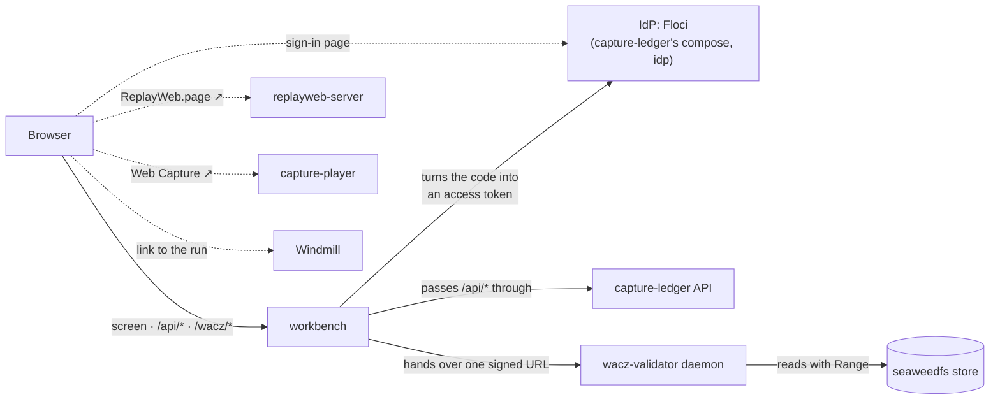

capture-workbench is the web app you open locally while developing
[Web Capture](https://uraitakahito.github.io/capture-ledger/#web-capture) (the set of repositories
that captures web pages into archives you can check later). **It shows one crawl as one row.** You
can also start a new crawl and read the contents of a captured WACZ.

A crawl is started by [capture-ledger](https://github.com/uraitakahito/capture-ledger) (the ledger
that decides which URLs get captured and records what came back), run by
[capture-scheduler](https://github.com/uraitakahito/capture-scheduler) (which drives crawls with
Windmill flows), stored in [seaweedfs](https://github.com/uraitakahito/seaweedfs) (the
S3-compatible store Web Capture shares) and opened with
two viewers: [replayweb-server](https://github.com/uraitakahito/replayweb-server) (unmodified ReplayWeb.page, which plays a WACZ back in the browser) and [capture-player](https://github.com/uraitakahito/capture-player) (a modified ReplayWeb.page that also shows what BrowserHive adds to a WACZ). A WACZ
(Web Archive Collection Zipped) is the archive format that packs the captured pages into a single
ZIP.

## Wiring

The browser talks to the workbench (same origin), and to the IdP (identity provider) only for its
sign-in page. Locally the IdP is [Floci](https://github.com/floci-io/floci) (a Cognito emulator),
which capture-ledger's compose runs as the service `idp`; in production it is Amazon Cognito. The
workbench turns the code that comes back from the sign-in into an access token (authorization code
with PKCE, Proof Key for Code Exchange) and passes `/api/*` straight through to the ledger with it. The writes are
`POST /api/crawls`, when you start a crawl from the form, and the routes for schedules ([Routes](/routes/)), sent the same way. For
validating a WACZ and reading its contents, it asks the ledger to sign a URL and hands that URL to
the daemon of [wacz-validator](https://github.com/uraitakahito/wacz-validator) (the validator that checks a WACZ rule by rule), which reads the archive itself. replayweb-server, capture-player and Windmill are only linked to from the rows.

## Promises

- **It holds no secrets.** Its app client at the IdP is public, with no secret. The tokens from
  your sign-in live only in the server's memory, and the browser holds only a session cookie.
  `.env` only says which IdP and where to look; there is nowhere to put a key or a token.
- **Locally, the sign-in is not a boundary.** Floci's admin API accepts its default key, so
  anything that reaches it can make a user and sign in as that user. The sign-in here is a
  convenience, not a protection, and the workbench stays on loopback
  ([Configuration](/configuration/#signing-in)).
- **It has no npm dependencies.** The workbench is built from the Node standard library and plain
  JavaScript that runs as-is in the browser, plus two committed bundles in `public/vendor/`: one
  colors the scripts (`shiki.js`) and one turns the dictionaries of the screen's text into
  sentences (`intl-messageformat.js`). What has dependencies is the source of this site
  (`docs-site/`) and what those bundles are built from (`highlighter/`), see
  [Development](/development/).
- **It only relays.** None of the workbench's logic lives on the server. The moment it did, there would be a
  copy of what the ledger knows.
- **It owns no wording of the validation.** Validation messages, in the language the page asks
  for, and the spec sections all come back from the daemon already resolved, and are shown as they
  are. If the workbench rephrased them,
  it would quietly drift from what the validator has started to say.

## Not published

The workbench binds to `127.0.0.1` only and is served over plain http. Chrome's Private Network
Access (PNA, which blocks requests from public pages to your local network) stops an https page
from calling `127.0.0.1`. So there is no way to put **the workbench** on GitHub Pages. What lives on
Pages is this documentation only.

## Where to go next

- **[Quickstart](/quickstart/)** — bring the workbench up, sign in and grant your user access, fix things
  from the message you see.
- **[Screens](/screens/)** — what each view shows, how states are worded, how often it polls.
- **[Inspecting a WACZ](/wacz/)** — the two steps of validation, the report, the WACZ view.
- **[Configuration](/configuration/)** — the environment variables and the order they are read in.
- **[Routes](/routes/)** — what the server answers, which headers pass, what failures look like.
- **[Development](/development/)** — where the dependencies stop, what the tests do not see,
  editing these docs, releasing.
