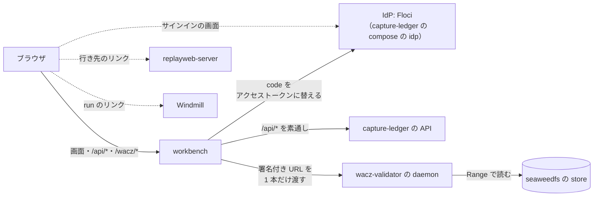

capture-workbench は、[Web Capture](https://uraitakahito.github.io/capture-ledger/ja/#web-capture)（Web ページを撮ってアーカイブに残し、後から確かめられるようにする repo の一式）を開発するときに手元で開く Web アプリです。
**1 本のクロールを 1 行で見ます。**
新しいクロールを始めることも、撮れた WACZ の中身を読むこともできます。

クロールを始めるのは [capture-ledger](https://github.com/uraitakahito/capture-ledger)（どの URL を撮るかを決め、撮れたものを記録する台帳）、
走らせるのは [capture-scheduler](https://github.com/uraitakahito/capture-scheduler)（クロールを Windmill の flow で回す）、
撮れたものを置くのは [seaweedfs](https://github.com/uraitakahito/seaweedfs)（Web Capture が共有する S3 互換の store）、
開いて読むのは [replayweb-server](https://github.com/uraitakahito/replayweb-server)（WACZ をブラウザで再生する画面）です。
WACZ（Web Archive Collection Zipped）は、撮ったページを 1 つの ZIP にまとめたアーカイブの形式です。

## 配線

ブラウザが話す相手は workbench（同一オリジン）と、サインインの画面のときだけの IdP（Identity Provider。サインインするサービス）です。
手元の IdP は [Floci](https://github.com/floci-io/floci)（Cognito を真似るもの）で、capture-ledger の compose がサービス `idp` として動かします。
本番は Amazon Cognito です。
workbench はサインインから戻ってきた code をアクセストークンに替え（authorization code と PKCE。PKCE は Proof Key for Code Exchange）、それを付けて `/api/*` をそのまま台帳へ通します。
書くのは、新しいクロールの画面から始めるときの `POST /api/crawls` と、定期実行の予定を作って操作するエンドポイント（HTTP の method と path の組。[エンドポイントの一覧](/routes/)）で、同じ道で台帳へ通します。
WACZ の検証と中身は、台帳に署名してもらった URL を [wacz-validator](https://github.com/uraitakahito/wacz-validator)（WACZ を規則ごとに検証する検証器）の daemon に渡して読ませます。
replayweb-server と Windmill へは、画面の行からリンクで飛ぶだけです。

## 約束

- **秘密を持たない。**
  IdP での app client は public で、secret を持ちません。
  サインインで得たトークンはサーバのメモリにだけ置き、ブラウザが持つのはセッションの cookie だけです。
  `.env` に書くのは「どの IdP か」と「どこを見るか」だけで、鍵にもトークンにも置き場がありません。
- **手元のサインインは、境界ではない。**
  Floci の管理の API は既定の鍵を通すので、Floci に届くものは利用者を作り、その利用者としてサインインできます。
  ここのサインインは便利さであって守りではなく、workbench は loopback の外に出しません（[設定](/configuration/#サインイン)）。
- **npm の依存を持たない。**
  workbench は node の標準ライブラリと、ブラウザで素のまま走る JS、それにスクリプトに色を付ける commit 済みの 1 ファイル（`public/vendor/shiki.js`）で建っています。
  依存が在るのは、このサイトの原稿（`docs-site/`）と、その 1 ファイルを作る元（`highlighter/`）です（[開発](/development/)）。
- **中継するだけ。**
  workbench のロジックはサーバに置きません。
  置いた瞬間に「台帳が知っていることの写し」が生まれるからです。
- **文を持たない。**
  検証の message も、日本語も、仕様の節も、daemon が解決して返したものをそのまま出します。
  workbench が言い換えると、検証器が言い始めたことと静かにずれていきます。

## 公開しない

workbench は `127.0.0.1` にだけ bind し、http で配ります。
https のページから `127.0.0.1` を叩くと、Chrome の Private Network Access（PNA。公開のページから手元のネットワークへの要求を止める仕組み）が止めます。
だから**workbench を** GitHub Pages に置く道はありません。
Pages に置いてあるのは、この説明だけです。

## 次に読むもの

- **[クイックスタート](/quickstart/)** —— workbench を起こす、サインインして許可を付ける、出た文から直す。
- **[画面](/screens/)** —— 画面ごとに何が並ぶか、状態の言い方、引く間隔。
- **[WACZ を見る](/wacz/)** —— 検証の 2 段と報告、WACZ の画面。
- **[設定](/configuration/)** —— 環境変数の表と、読む順。
- **[エンドポイント](/routes/)** —— サーバが答えるエンドポイント、通すヘッダ、失敗の形。
- **[開発](/development/)** —— 依存の線、試験が見ないもの、docs を直す、リリース。
