capture-workbench は、上のタブで切り替える画面からなります。
URL の `#` が画面を決めます（`#crawls`・`#start`・`#schedules`・`#changes`・`#archives`・`#search`・`#scripts`。検索の画面では探した語も、変化の画面では開いた回とページも、スクリプト集の画面では読んでいる物も URL が名指します）。
WACZ の画面のタブは、アーカイブの行の「開く」で入るまで出ません。

このページの絵は、代役（[サンドボックス](/development/#サンドボックスで開く)）を相手に撮っています。
代役のスクリプトは capture-scripts の写しで、本物の capture-ledger と同じ物が並びます（autoscroll v2 だけは、版のリンクを見せるための代役の版です）。

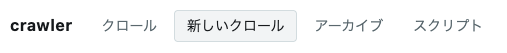

| 画面 | 何が並ぶか |
| --- | --- |
| クロール | 1 行 = 1 本。状態・撮れた数・リンクの数・WACZ（撮ったページを 1 つの ZIP にまとめたアーカイブ）の数・かかった時間・run と replayweb-server（クロールを 1 つのアーカイブとして）への行き先 |
| 新しいクロール | 起点の URL・スクリプト・深さを選び、スクリプトが宣言した変数の値を書き、その場の TS を書いて始める。TS の箱は窓の高さいっぱい。スクリプトは右の列のタブで読める |
| 定期実行 | 予定と回。予定を止める・再開する・いま撮る・固定し直す・消す。撮れなかった回は全部の画面の帯に出る |
| 変化 | 予定の回を前の回と比べた結果。回ごとのまとめと、開くと左に回の全ページの目次、右に選んだ 1 ページの差分・Claude の 1 行（証拠ではない）・前と今の再生の link（ReplayWeb.page ↗・Web Capture ↗） |
| アーカイブ | 見えている WACZ（一覧）。行から検証・WACZ の画面・[replayweb-server](https://github.com/uraitakahito/replayweb-server)（WACZ をブラウザで再生する画面）へ |
| 検索 | capture-ledger の全文検索。語を打って探し、当たったアーカイブの時点（文書か写し）を並べる。行から WACZ の画面と replayweb-server へ |
| スクリプト集 | ページの中で走らせるスクリプトと、書くための型。行番号つきで読め、古い版も読める。空なら赤で言う |
| WACZ | WACZ 1 本の中。[WACZ を見る](/wacz/)に書いた |

画面の上には、誰としてサインインしているかと、「サインアウト」のリンクが出ます（「… (…) としてサインインしています」）。
足元には、いま並んでいる行の数と、次に引くまでの間隔が出ます。

## 並ぶのは capture-ledger の 1 ページ

クロールとアーカイブは、capture-ledger が返す最初の 1 ページ（新しい順）だけを並べます。
workbench は続きを取りに行きません。
アーカイブは、そのページの中から名乗りが見てよいものだけが返るので、1 ページの数より少ないことがあります。
足元の「クロール N 本 ／ アーカイブ N 本」は並んでいる行の数で、capture-ledger に在る全部の数ではありません。

開いたクロールの行の「ページ」の表（capture-ledger がそのクロールに記録したページの一覧）も、最初は capture-ledger が返す 1 回分だけを並べます。
続きは「続きを読む」を押したときだけ引き、押して読んだ所までは、引き直しても並べ直します。

## クロール

1 行が 1 本のクロールです。
状態・id の先頭 8 文字・始めた人と組織・最初の起点の URL・撮れた数・リンクの数・WACZ の数・かかった時間が並び、右端の「run ↗」が Windmill の run を新しいタブで開きます。
capture-ledger がクロールの合本を書いていれば、隣の「ReplayWeb.page ↗」と「Web Capture ↗」が、クロールを 1 つのアーカイブとして replay で開きます。

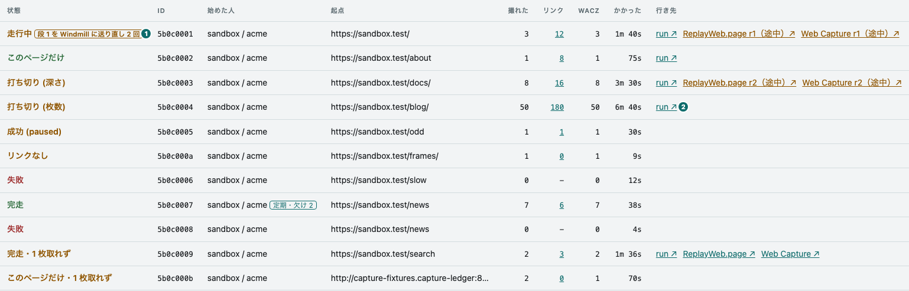

① 状態\
② run の行き先

- **撮れた数とリンクの数は、欄を分けてある。**
  リンクの数（`pagesDiscovered`）は、撮ったページにあったリンクのうち規則が通した本数です。撮らなかった物も入るので、撮れた数の分母ではありません。
  深さ 0 のクロールでも数えます（辿らないだけです）。
  capture-ledger v0.83.0 より前に始めた深さ 0 のクロールは数えていないので、0 と出ます。
- **撮れた数が 0 の行は、リンクの数が `−`。**
  数えるページが無いので、「0 本だった」とは言いません。
- **かかった時間は、走行中なら「いままで」。**
  終わった時刻が無いのは「まだ終わっていない」であって、「時間が無い」ではありません。
- **run ↗ は、最後に投げた段の run。**
  行き先は、capture-ledger が返す `lastJob` の id と、サーバが `/healthz` で配る Windmill の origin と workspace から組みます。
  capture-ledger が `lastJob` を持たない行には出ません。
- **段を Windmill に送り直したら、状態の隣に言う。**
  capture-ledger は段を Windmill に渡せたかを確かめられないと、同じ段の鍵で送り直します（CAPTURE-180）。
  一番新しい段を 2 回以上送ったか、最後の誤りが残っていれば、状態の隣に「段 1 を Windmill に送り直し 3 回」のように出て、印に指を置くと最後の誤りが出ます。
  10 分経っても渡せず諦めた段は、赤で「段 1 を Windmill に渡せず諦めた（21 回送った）」です。
  1 回で渡せた段には何も出ません。数は capture-ledger の `dispatch`（一番新しい段の `attempts`・`lastError`）で、送った回数から 1 を引いた物が送り直しです。
- **ReplayWeb.page ↗・Web Capture ↗ は、クロールを 1 つのアーカイブとして開く。**
  capture-ledger は段ごとに、クロールの合本を保管庫へ書きます。
  合本は、クロールの WACZ を全部並べた `replay.json` と、ページの一覧（`pages.json`）の組です。ReplayWeb.page がページを引くと、replayweb-server がこの一覧から答えます。
  replay は合本を 1 つのアーカイブとして開くので、撮ったページのリンクから、別の WACZ に撮ったページへ行けます。
  行き先は、サーバが `/healthz` で配る replayweb-server の origin と、capture-ledger が指す版の鍵（`replayBundle.key`）から組み、ページ一覧（`#view=pages`）を開きます。
  合本の無いクロール（まだ何も撮っていない・合本を書かない capture-ledger）の行には出ません。
  capture-ledger は、合本を書けなくてもクロールを止めません。開いた行の先頭に書けなかった理由を capture-ledger の文のまま（`replayBundle.error`）出し、ReplayWeb.page ↗・Web Capture ↗ は前に書けた版があればそれを開きます。
  決まりは `public/replayweb.js` の `replayBundleHref` で、`test/replayweb.test.mjs` が固定しています。
- **途中の版は、字で言う。**
  走行中の行の ReplayWeb.page ↗・Web Capture ↗ は、その時点で capture-ledger が書けた途中の版を開きます。
  後の段で撮るページはまだ入っていないので、そのページへのリンクは replay で Not Found になります。
  そのため、字を `ReplayWeb.page r1（途中）↗ と Web Capture r1（途中）↗` にして、警告の色と説明を付けます。
  終わった行でも、指す版の `builtAt` が `finishedAt` より前なら同じです。
  flow は `report`（ここでクロールが終わる）の後に `replay_bundle`（ここで最後の版を書く）を走らせるので、最後の版は少し遅れて届きます。
  次の版を書けなかった行は、前の版を途中の版として開きます。
  開いた行のページの表は、字を増やさず、色と説明だけを付けます。
  決まりは `public/replayweb.js` の `isPartialBundle` で、`test/replayweb.test.mjs` が固定しています。

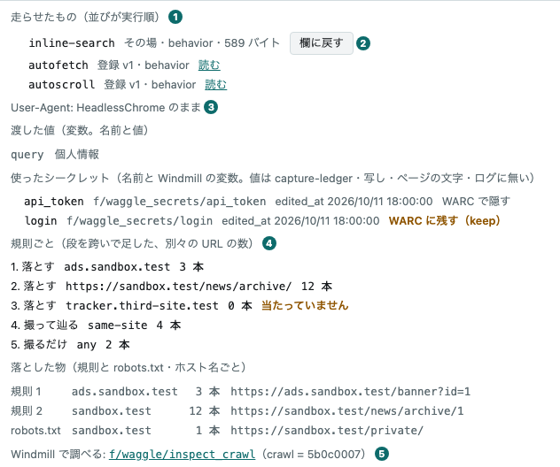

① 走らせたもの（並びが実行順）\
② 欄に戻す\
③ 渡した値（変数）と使ったシークレット\
④ 規則ごとの数\
⑤ Windmill で調べる（inspect_crawl へのリンク）

- **行を押すと、失敗の文・走らせたもの・渡した値・取れなかった URL が出る。**
  そのときだけ `/api/crawls/:id` を引きます。
  先頭は capture-ledger の `error` で、文は言い換えません（段を送り直したなら、その回数と最後の誤りがさらに前に出ます）。
  compile の段で落ちたクロールは 1 枚も撮っていないので、取れなかったページが空になり、それだけでは成功のように読めるためです。
  次が走らせたもので、並びが実行順です。
  登録済みのスクリプトは版と「読む」（押すと[スクリプト集](#スクリプト集)の画面で、そのクロールが走らせた版が開きます）を、その場で書いた物は「その場」と大きさ（バイト）を出し、その場の物には「欄に戻す」が付きます（押すと[新しいクロール](#新しいクロール)の画面へ移ります）。
  サイト用のスクリプトには対象サイト（`laws.e-gov.go.jp 用` のような印）が付きます。
  その次が渡した値です。
  始めるときに渡した変数（capture-ledger の `variables`）の名前と値と、使ったシークレット（`secrets`）の名前・Windmill の変数の path・capture-ledger が在るかを確かめたときの `edited_at`・WARC に値を残すか（`archive`）が並びます。
  シークレットの値は出ません。値は Windmill にだけ在って capture-ledger には無く、写し・ページの文字と題・ログからも消えます。
  WARC での扱いは宣言が決めます。「WARC で隠す」のシークレットは、スクリプトが通信に載せた値もサイトが返した値も、WARC の中で `***` に置き換わっています。
  「WARC に残す（keep）」は宣言に `archive: "keep"` と書いたシークレットで、値は通信の記録（WARC の request・response・metadata と、その URL）に値のまま残ります。
  上の絵では `api_token` が隠す物、`login` が残す物です（代役のクロール `5b0c0007`）。
  隠すのは BrowserHive v29.0.0 からです。それより前の取り込みでは、通信に載せた値が WARC に残っています。capture-ledger はそのころの行にも `archive: null` を返すので、印は「WARC で隠す」と出ます（印にポインタを重ねると、そのことも出ます）。
  クロールの途中で Windmill の変数が書き換えられていれば、どの段から替わったかが付きます。
  その上に、頼んだ `User-Agent` を打った字のまま出します（頼まなければ「HeadlessChrome のまま」）。
  何も渡していないクロールは「渡した値: なし」の 1 行で、値を持たない古い capture-ledger の行には何も出ません。
  最後が取れなかったページで、並ぶのは capture-ledger が返す新しい 5 件です（全部の数は状態の欄の「N 枚取れず」で分かります）。
  1 つも無ければ、そう言って起点の URL を並べます。
- **型の検査で落ちたクロールは、型の誤りを全部出し、直し方を訊ける。**
  capture-ledger の `error` が compile の段の 422 を言うとき、workbench は `/api/crawls/:id/diagnostics` も引きます。
  capture-ledger がクロールのスクリプトを ts-compile-service に送り直し、表には誤りが全部、スクリプト・行と列・code・文で並びます（`error` は capture-ledger の上限で切られ、最初の数件しか言いません）。
  表のために Claude は呼びません。
  型の誤りの在るその場の TS には、「欄に戻す」の隣に「直し方を訊く」が出ます。
  押したときだけ capture-ledger を通して Claude を呼び、capture-ledger は同じ検査に通った直しだけを返します。
  答えには、理由・置き換えた行（消した行と足した行を、行番号つきで）・往復の回数・費用と、「直した版を欄に戻す」が出ます。
  「直した版を欄に戻す」は「欄に戻す」と同じ動きで、source だけが直した版です（名前と phase は元のまま）。
  確かめたのは型だけです。差分を読み、撮って動きを確かめてください。
  ほかの答え（直す物が無い・通る直しが無い・この月の上限に届いた・capture-ledger にエンドポイント（HTTP の method と path の組）が無い）は、capture-ledger の文のまま 1 行で出ます。
- **開いた行には、規則が何を決めたかも出る。**
  capture-ledger の `/api/crawls/:id/decisions` を、詳しい所と一緒に引きます。
  まず規則ごとに、当たった別々の URL の数を段を跨いで足した物。1 度も当たらなかった規則には「当たっていません」と添えます。当たらない規則は、たいてい書いた人の意図と違うことを言っています。
  次に落とした物を、ホスト名ごとに。規則で落とした物・どの規則にも当たらなかった物・robots.txt のために取らなかったページです。
  リンクを 1 本も見ていないクロールは、全部の規則に 0 を並べず、そう 1 行で言います。
  最後が「Windmill で調べる」のリンクで、Windmill の `f/waggle/inspect_crawl` を、このクロールの id を入れた状態で開きます（Windmill は run の引数を URL の hash に持ちます）。

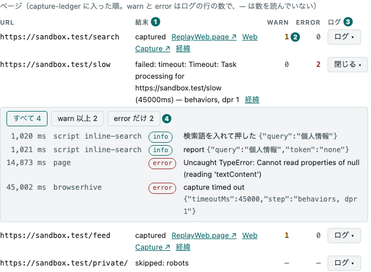

① 結末（capture-ledger の state と理由。合本に入ったページには ReplayWeb.page ↗・Web Capture ↗）\
② warn と error の数\
③ ログ（押すと開き、もう 1 度押すと閉じる）\
④ level の絞り込み

- **開いた行には、ページの表も出る。**
  capture-ledger の `/api/crawls/:id/pages` を、詳しい所と一緒に引き、規則の判断の後に並べます。
  並びは capture-ledger に入った順で、URL・結末・warn と error の数・「ログ」の button が並びます。
  結末は capture-ledger の state（`captured`・`failed` など）を言い換えずに出し、理由（取らなかった・取れなかった理由）があれば後ろに付けます。
  capture-ledger は、報告の来なかったページを `pending` のまま残します（撮れたかは分からない）。なので、終わったクロールのそういうページは「`pending`（報告なし —— クロールが先に終わった）」と出します。型の検査で落ちたクロールは 1 枚も撮っておらず、そのままでは起点のページが、まだ待っているように読めるためです。
  capture-ledger が指す合本に WACZ が入ったページは、結末の後ろに「ReplayWeb.page ↗」と「Web Capture ↗」が付き、そのページを合本の中で、撮った時刻に開きます（`#view=replay&url=…&ts=…`）。
  決め手は capture-ledger の `bundledRev`（そのページの WACZ が最初に入った版）で、開いた行の `replayBundle` が指す版より後でなければ付きます。
  WACZ の無いページ・まだどの版にも入っていない WACZ・行と一緒に引いた版より新しい版に入った WACZ には付きません。
  warn と error は、capture-ledger がその取り込みの `.result.json` から数えたログの行の数です。数を読んでいないページは「—」で、0 とは別です。
  並べるのは capture-ledger の 1 回分で、続きがあれば「続きを読む」が出ます。
  capture-ledger にページのエンドポイントが無ければ（古い capture-ledger）、そう 1 行で言います。
- **「ログ」で、そのページのログの行が出る。**
  押したときに、capture-ledger の `/api/crawls/:id/pages/:page/log` を 1 度だけ引きます（閉じて開き直せば、また引きます）。
  行は届いた順で、取り込みの始まりからの ms・出どころ（スクリプトの行は `script` とスクリプトの id、取り込みのページの console と例外は `page`、BrowserHive 自身の行は `browserhive`）・level・文・data が並びます。
  誰の行かは BrowserHive が付けるので、スクリプトの側で id を書く所はありません。
  文は言い換えず、data は JSON のまま文の後ろに続けます。
  絞り込みは「すべて」が既定で、「warn 以上」「error だけ」も選べます。数は、その絞り込みで並ぶ行の数です。
  BrowserHive が 1 行の上限で切った行には「途中で切った」が付き、残さなかった行があれば「N 行は残していない（上限か方針で）」が出ます（取り込みの上限を超えて捨てた行と、方針で伏せた文書が console に書いた行。どちらの理由かは、ログの中の browserhive の行が言います）。
  ログを読めないページは、capture-ledger が言う理由を短い文と理由の字で出します（まだ撮っていない・撮らなかった、`.result.json` の場所が無い・保管庫に無い・契約に合わない、ログを残す前の BrowserHive で撮った）。
  ページに WACZ が在れば、箱の上の「WACZ の画面で開く」から、WACZ に封じた同じ行（`logs/capture.jsonl`）を WACZ の画面で開けます。WACZ の行は答えの行に `profile` を足しただけで、署名が覆います。BrowserHive が WACZ Profile 1.19.0 より前に撮った WACZ には、この entry はありません。
- **開いた行は、引き直しても閉じない。**
  表は引くたびに作り直すので、開いている行を id で覚えておき、最後の答えで開き直します。
  引き直すのは、走行中か、状態が変わった行だけです。
  開いたログも、ページの id で覚えておき、箱を作り直さずに移すので、流した位置と絞り込みごと残ります。
  忘れるのは、行を閉じた時と、クロールが一覧から消えた時です。

### 状態は stopReason と合わせて言う

`state` だけでは足りません。
`succeeded` には、全部を辿り終えた完走と、深さや枚数の上限で切った打ち切りが混ざっています。
workbench は `stopReason` と合わせて「完走」「打ち切り (深さ)」のように言い分け、知らない `stopReason` は括弧に入れてそのまま見せます。
深さ 0 のクロールは、辿らないと頼んだのだから打ち切りではないので、リンクが残っていても「このページだけ」と言います（capture-ledger の一覧の `maxDepth`）。
辿るよう頼んだのに、規則が通したリンクが 1 本も無かったクロールは「リンクなし」（注意の色）です（capture-ledger の `no_links`）。起点から 1 歩も進めなかったことを、緑の「完走」と分けて見せます。
取れなかったページがあれば「完走・2 枚取れず」のように数（capture-ledger の `pagesFailed`）を添え、全部を辿っていても緑にしません。
1 枚も撮れなかったクロールは capture-ledger が `failed` で締めるので、「失敗」です。

言い分けの規則は `public/format.js` の `stateOf` で、`test/format.test.mjs` が固定しています。
ブラウザが読むのと同じファイルを試験も読むので、写しが腐りません。

## 新しいクロール

タブ「新しいクロール」の画面から、クロールを始めます。
左の列に起点の URL・スクリプト・クロールごとの値（チェックしたスクリプトが宣言していれば）・User-Agent の箱・深さと「始める」、右の列にその場の TS の箱と辿り方が並びます。
右の列はタブで、スクリプトを読む窓に切り替わり、「リンクを辿る」を選んでいる間は「辿り方」にも切り替わります。
箱は窓の高さいっぱいまで伸び、左に行番号が付きます。巨大な JS を貼って、読んで、少し直して始めるための形です。
起点の URL を 1 行に 1 本書き、「このページだけ」か「リンクを辿る」を選んで「始める」を押します。

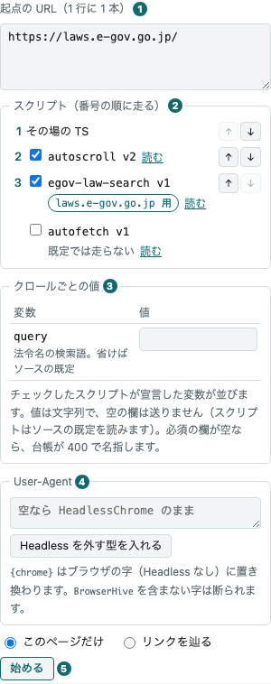

① 起点の URL\
② スクリプト（走る順の番号・チェックと「読む」・↑↓）\
③ クロールごとの値（チェックしたスクリプトが宣言した変数の欄）\
④ User-Agent（箱と、Headless を外す型を入れるボタン）\
⑤ 始める

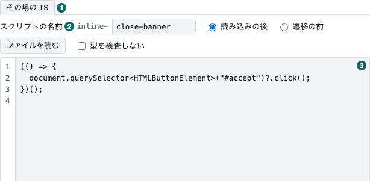

① 右の列のタブ\
② スクリプトの名前\
③ TS の箱

- **送るのは、起点の URL と、深さ 0 かどうかと、走らせるもの（既定から変えたときだけ）と、クロールごとの変数（値を書いたときだけ）。**
  「このページだけ」は `maxDepth: 0` を送ります。「リンクを辿る」は規則を送り、深さと枚数は書いたときだけ送ります（空なら capture-ledger の既定）。
  起点で決まる既定の顔ぶれ（既定に入るスクリプトのうち、対象サイトの無い物と、起点に合うサイト用の物）を選んだまま順も動かさず、その場の TS も無ければ、`scripts` は送りません。capture-ledger も起点から同じ物を同じ順で選んで走らせます。
  登録済みのスクリプトが無ければ今までどおり 400 で、スクリプトは在るのに起点に合う物が 1 つも無ければ、別の文の 400 です。
  そうでなければ `scripts` を番号の順で送ります（「遷移の前」のその場の TS は先頭）。全部外せば `[]` で、何も走らせません。
  URL もスクリプトの名前も workbench では検査せず、capture-ledger が 400 で言います（断った id を名指します）。
- **走る順は番号で見え、↑↓ で変えられる。**
  チェックの付いた行に番号が付き、その順に走ります。初めは [capture-scripts](https://github.com/uraitakahito/capture-scripts) の `catalog.json` の順で（capture-ledger v0.75.0 から）、`autofetch` を付けるだけなら `autoscroll` の後に走ります。
  ↑↓ は番号の行どうしを入れ替えます。チェックを外しても行は動かず、番号と矢印が消えるだけです。起点に合わないサイト用の行は下にまとまります。
  「読み込みの後」のその場の TS は、書くと行が出て（初めは先頭）、一緒に動かせます。「遷移の前」の物は行に出ず、いつも最初に走ります。
  動かした順は一覧の引き直しでも、始めた後でも残り、ページを読み直すと元に戻ります。
- **サイト用のスクリプトは、起点がそのサイトのときだけ選べる。**
  対象サイトのあるスクリプトは、起点のどれかが対象サイトのホストにあるときだけチェックを押せます。照らすのは起点のホスト名との完全一致で、ポートは見ません（`laws.e-gov.go.jp` と `www.e-gov.go.jp` は別のホスト）。
  起点を書くと、合うスクリプトには自動でチェックが付き、合わないスクリプトは押せなくなって「起点に laws.e-gov.go.jp がありません」のように理由が出ます。起点が空なら「起点を書くと選べます」です。
  見本は capture-scripts の `egov-law-search`（対象サイト `laws.e-gov.go.jp`）で、[e-Gov 法令検索](https://laws.e-gov.go.jp/)の頁の中で法令名を必須の変数 `query` の語で検索します。起点に `https://laws.e-gov.go.jp/` を書くと選べます（上の絵）。
  外したチェックは覚えていて、起点を書き換えても付け直しません。決まりは capture-ledger と同じで、合わないスクリプトを名指して送れば、capture-ledger が 400 で断ります。
- **User-Agent の箱で、クロールの `User-Agent` を決める。**
  空なら何も送らず、ブラウザの字（`HeadlessChrome` を含む）のまま撮ります。
  「Headless を外す型を入れる」を押すと `{chrome} BrowserHive` が入ります。`{chrome}` は BrowserHive がブラウザの字から Headless を外した物に置き換えるので、Headless を断るサイトも撮れ、ブラウザを上げても字が古くなりません。
  たとえば[首相官邸の公式サイト](https://www.kantei.go.jp/)は、`HeadlessChrome` を含む字に HTTP 404 を返します。欄を空のまま「このページだけ」で始めると、ページの結末が `failed: http_error: HTTP 404: Not Found` になり、1 枚も撮れず ReplayWeb.page ↗・Web Capture ↗ も出ません。ボタンで `{chrome} BrowserHive` を入れて始めると撮れて、ReplayWeb.page ↗・Web Capture ↗ で開けます（2026-11-07 に確かめました。相手のサイトの答えは変わることがあります）。
  `BrowserHive` の語を含めるかは打つ人が決めます。含むと、相手のサイトに BrowserHive が撮っていると分かり、robots.txt もその名前の規則で読みます。含まなければ `*` の規則だけを読みます。
  workbench は字を検査しません。形（印字可能な ASCII・512 字以下）に合わない字は capture-ledger が 400 で断り、その文をそのまま出します。
  始めた後も、字は変数やスクリプトと同じく欄に残ります。クロールの画面の開いた行には打った字が出て、実際に送った字は WACZ の `settings.userAgent` で読めます。
- **チェックしたスクリプトやその場の TS が値を宣言していれば、「クロールごとの値」の欄が出る。**
  スクリプトは読む変数を、ソースの `const { query } = defineParams(z.object({ query: z.string().min(1).describe("…") }))` で宣言します。[capture-scripts](https://github.com/uraitakahito/capture-scripts) のスクリプトは `catalog.json` の `params` にも同じ宣言があり、capture-ledger は版ごとに持ち、`GET /api/scripts` が運びます。
  その場の TS は、箱が 800 ms 止まると capture-ledger に訊きます（`POST /api/scripts/check`）。ファイルを読んだときも、「欄に戻す」でも、「下敷きにする」でも欄が出ます。
  変数（`kind: variable`）の宣言は、名前と説明と値の欄の 1 行になります（`z.enum` の宣言は選択の欄）。上の絵の `query` は `egov-law-search` が法令名の検索語として宣言した物です。必須の宣言（`.optional()` の無い物）には「必須」の印が付きます。
  値を書いた欄だけを `variables` で送ります。任意の欄が空なら送らず、スクリプトは `undefined` を読みます。
  書いた値は覚えていて、202 の後も、チェックを外して欄が消えても残り、付け直せば欄に戻ります。
  workbench は値を検査しません。名前の綴り（英小文字で始め、英小文字・数字・`_` で 64 字まで）・1 クロール 32 個・値は 4,096 字まで・スクリプトが宣言した形は capture-ledger の決まりです。必須の欄が空のときと、どのスクリプトも宣言していない名前のときと、形に合わない値のときは、capture-ledger が行を立てる前に 400 で名前を名指します（左の列の下に `400 —— missing variables: query` のように出ます）。
  その場の TS の宣言を読めないときと、capture-ledger に訊けないときは、箱の下に赤で理由が出ます。`BH0002`（走らせずに読める形でない）、`BH0004`（「遷移の前」のスクリプトには変数を読む先が無い）、「宣言を確かめられません」と capture-ledger の文、のどれかです。ふつうの型の誤りはここには出ません。走らせたときに compile の段が言います。
  シークレット（`kind: secret`）の宣言は「使うシークレット」として名前だけが並び、値の欄はありません。名前の横に、WARC で隠すか残すか（宣言の `archive`。省けば隠す）が出ます。
  値は Windmill の変数 `f/waggle_secrets/<名前>` に人が置きます。capture-ledger が在るかを確かめ（無ければ 400 で名前と path を名指します）、クロールのたびに Windmill の中で解いてスクリプトに渡します。値は workbench にも capture-ledger にも残りません。
  WACZ では、隠すシークレットの値は WARC の中で `***` に置き換わり、`archive: "keep"` と宣言した物は値のまま残ります。どちらも写し・ページの文字と題・ログからは消えます。隠す値は 8 字以上が要り、短い値を渡した取り込みは BrowserHive が断ります（capture-scripts の README の「WARC に残すか」）。
  隠すシークレットを使うのに、配備の形式（capture-ledger の `CAPTURE_LEDGER_CAPTURE_FORMATS`）に PNG・WebP・HTML・MHTML のどれかがあると、値を置き換えられないので capture-ledger が行を立てる前に 400 で断ります。左の列の下に `400 —— formats that cannot hide secrets: api_token（CAPTURE_LEDGER_CAPTURE_FORMATS の png は値を置き換えられない …）` のように、名前と直し方が出ます。
  同じ名前を、残す宣言と隠す宣言の両方ですると `400 —— conflicting params: api_token` です。
  同梱のスクリプトにシークレットを宣言する物は無く、この画面から渡せるのは変数だけです。その場の TS がシークレットを宣言する（`inline.params`）のは、capture-ledger の API に直に送るときだけです。
- **既定では走らないスクリプトは、外れた状態で並ぶ。**
  名前の横に「既定では走らない」と出ます（上の絵では autofetch）。[capture-scripts](https://github.com/uraitakahito/capture-scripts) の `catalog.json` に `"default": false` と書いたスクリプトで、capture-ledger はその全部の版を無効にして持ちます。何も名指さないクロールでは走りません。
  付ければ名指して送り、capture-ledger はその最新版を走らせます。付けたチェックも外したチェックと同じく覚えていて、引き直しても戻しません。
- **送る前に、本文の大きさを見せる。**
  箱の下に、行数・送る本文の大きさ（UTF-8 のバイト）・上限に対する割合が出ます。
  上限は書き込みのエンドポイントと同じで、サーバが `/healthz` の `writeLimit` で配ります。超えると赤で言い、「始める」を押せなくなります。
- **スクリプトの名前が、そのスクリプトの id になる。**
  右の列の「スクリプトの名前」の欄に、その場の TS の名前を書きます。前の `inline-` は付いたままで、たとえば `close-banner` なら id は `inline-close-banner` です。
  綴りは英小文字で始め、英小文字・数字・`-` だけで、57 字までです（capture-ledger の決まり）。workbench は検査しません。違えば、名前が空でも、capture-ledger が 400 で断り、左の列の下に `body/scripts/0/inline/name must match pattern "^[a-z][a-z0-9-]*$"` のような文が出ます。
  名前を送るのは、箱に何か書いてあるときだけです。箱が空なら、名前は使いません。
  id は、クロールの行の「走らせたもの」と、ページのログの行の出どころと、アーカイブの `behaviors/custom.jsonl` に出ます。ログ（`__bh.log.info(…)` など）と報告（`__bh.report(…)`）の行には BrowserHive がこの id を付けるので、スクリプトの中に id を書く所はありません。「欄に戻す」も、この名前で TS を取り戻します。
- **その場の TS は、strict で型を検査されます。**
  最初の段の compile で検査され、1 つでも誤りがあればクロールごと落ちます。診断は件数と最初の 5 件が、行を開くと読めます。
  IIFE で包み、取り出す要素には型を付けて `?.` で扱ってください。`export` は書けません。compile が `BH0006` で止めます（ページでは構文エラーになり、何も走らないため）。
- **Zod を使えます。**
  先頭の文に `import { z } from "zod"` か `import * as z from "zod/mini"` を書きます。ほかの形は compile が `BH0003` で止め、「遷移の前」では `BH0004` で止めます。
  ts-compile-service が使う名前だけを JS に束ねるので、スクリプトは 85 KB ほど大きくなります（`zod/mini` は 15 KB）。形が合わなくてもクロールは成功のままなので、`parse` より `safeParse` と `__bh.log.error` を使ってください。
- **束ねた JS は「型を検査しない」で。**
  チェックを入れると箱の 1 行目に `// @ts-nocheck` が入り、外すと消えます。見えている物が送る物で、capture-ledger が打つ sha256 にも入ります。
  貼った JS が 1 行目に印を持っていれば、チェックは付いた状態になります。
- **箱は折り返さない。**
  行番号とずれないように、長い行は横に流します。
  「読み込みの後」は主フレームで 1 回、「遷移の前」は全部のフレームで遷移のたびに走り、受け皿（`__bh`）がありません。
  「ファイルを読む」は、別の所で書いたファイルを箱に読み込みます（ブラウザの中だけで読みます）。スクリプトの名前の欄が空なら、拡張子を除いたファイル名が入ります。綴りが決まりに合わなければ（大文字や `_`）、直してから始めてください。
- **スクリプトは、右の列で読める。**
  チェックの横の「読む」を押すと、右の列に 2 つ目のタブ（`autoscroll v2` のような名前）が開き、そのチェックの版の source が色つきで出ます。画面は移りません。
  TS の箱は隠れるだけで、書きかけも流した位置も残り、タブ「その場の TS」で戻ります。読みながらチェックを付け外しできます。押せないサイト用のスクリプトの横の「読む」も押せます。
  開いておけるのは 1 つで、別の「読む」で入れ替わり、× で閉じます。窓には「写す」「下敷きにする」と、スクリプト集の画面で開くリンクがあります（版のリンクと行の URL は[スクリプト集](#スクリプト集)の画面にだけ在ります）。
  ⌘ や Ctrl を押しながら押すと、ブラウザがスクリプト集の画面を別のタブで開きます。

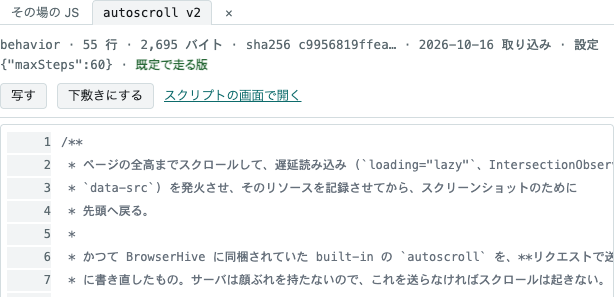

- **202 と 409 は、クロールの画面へ移る。**
  受理されたら始めた行に、走行中のクロールがあれば塞いでいる行に印が付きます（capture-ledger は全体で 1 本しか走らせません）。
  受理されたので、足元は 2 秒ごとに引くようになります。
  それ以外（400・413・届かない）はこの画面に残り、左の列の下に capture-ledger の文をそのまま出します。
- **202 の後、起点の URL は消え、その場の TS と変数の値は残る。**
  直して撮り直すことが多いからです。
- **「欄に戻す」で、この画面に戻る。**
  クロールの画面で行を開き、その場の TS の「欄に戻す」を押すと、この画面へ移り、名前・phase・TS が戻ります。
  TS は capture-ledger の `/api/crawls/:id/inline/:name` から取ります（行の詳しい所には大きさしか載りません）。起点とスクリプトの選びは触りません。
  右の列で読んでいても、タブ「その場の TS」に替わります。
- **[スクリプト集](#スクリプト集)の画面の「下敷きにする」で、スクリプトがこの画面に来る。**
  名前の欄が空なら `my-<id>` が入ります。替えるのは、そのスクリプト自身の id を名指す形 `__bh.opts["<id>"]`（設定を読む所）だけで、`inline-<名前>` にします。報告とログの行は id を取らないので、替えません。替えた行は左の列の下に出ます。
  元のスクリプトのチェックは外します（両方走ると 2 回走ります）。箱に書きかけがあれば、スクリプト集の画面で置き換えるかを訊きます。
  右の列の読む窓の「下敷きにする」も同じです（確認は読む窓の中で訊きます）。写した後はタブ「その場の TS」に替わり、読む窓は開いたままなので、元と見比べられます。
  サイト用のスクリプトを下敷きにしても、対象サイトは写しに付きません。その場の TS はどの起点でも走るので、スクリプトの冒頭の見分け（`location.hostname` を比べる行）が、ほかのサイトでは何もさせません。
- **受け皿（`__bh`）の型は、注意書きのリンクから読める。**
  左の列の下の注意書きに、型へのリンク（`#scripts/types/host.d.ts`）があります。ふつうに押すと、右の列の読む窓に開きます。
- **「リンクを辿る」を選ぶと、「辿り方」のタブが開く。**
  深さと枚数・型・規則の表が並びます。規則は「動き」と「当てる物」の組です。
  動きは「撮って辿る」「撮るだけ」「落とす」、当てる物は `same-origin`・`same-host`・`same-site`・`any`（起点と比べる）、小文字のホスト名（そのホストとその下のサブドメイン）、`http(s)` の URL（前方一致）のどれかです。
  capture-ledger は上から当て、最初に当たった規則が決め、どれにも当たらないリンクは落とします。
  タブは「ホストの中」で始まります。型「サイトの中」「サイトの中＋外は 1 歩」「ホストの中」「どこでも」は、どれも「撮って辿る」を 1 本持ちます。起点が撮って辿るに当たらないと、capture-ledger が断るからです。
  「＋ 落とす行を足す」は、いちばん上に足します。広い「撮って辿る」の下に置くと、覆われて二度と当たりません。
  ↑ ↓ × は行の番号を読み上げ、動かした行に focus が付いて行きます。

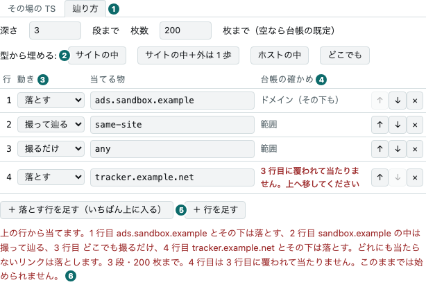

① 辿り方\
② 型\
③ 規則ごとの動き\
④ 確かめの答え（capture-ledger が行ごとに返す）\
⑤ 落とす行を上に足す\
⑥ 何を辿るかの言い直し

- **書いている間に、capture-ledger が規則を確かめる。**
  手が 300 ms 止まると、capture-ledger の `GET /api/crawl-rules/check` を引きます（何も書かないエンドポイントなので、一覧と同じ素通しに乗ります）。
  行ごとに、capture-ledger が読んだ種類（範囲・ドメイン・前方一致）か、赤い字で「読めません」「n 行目に覆われて当たりません」が出ます。
  表の下の文は、何を辿るかを capture-ledger の読んだ形で言い直します（URL の前方一致は正規化した形で出ます）。
  capture-ledger が「始められない」と言っている間は「始める」を押せません。capture-ledger に確かめられないときは止めません —— 始めれば capture-ledger が答えで言います。
- **始めた行は開かずに、印を付ける。**
  印は id で覚えておき、描き直しのたびに付け直します。

送る道は、[エンドポイント](/routes/)の `POST /api/crawls` です。

## 定期実行

予定と、その回が並ぶ画面です（`#schedules`）。
時計は [capture-ledger](https://github.com/uraitakahito/capture-ledger) の中に在り、この画面は状態を読んで操作を頼むだけです。

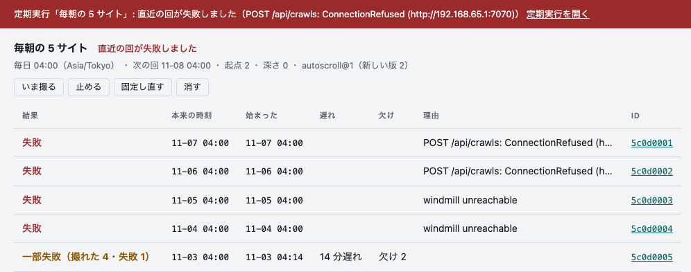

- **撮れなかった回は、全部の画面の帯に出る。**
  帯を出すのは、直近の回の失敗・次の回の 1 時間以上の遅れ・1 時間以上走ったままの回の 3 つと、状態を読めないときです。
  手では閉じません。
  原因が直ると消えます。
  タブにも、帯に出ている予定の数が付きます。
- **順番待ちは帯に出さない。**
  走れるクロールは全体で 1 本なので、走行中は期限が来ても待ちます。
  capture-ledger の起動と直近のクロールから 10 分（静かな時間）も待ちます。
  待っている間は期限が動かず、終わった後に始まります。
- **止まっていた間の回は 1 回にまとめる。**
  capture-ledger が止まっていた間の回は、戻ったときに 1 回だけ撮り、まとめた数を「欠け」に出します。
- **頁の一部だけ失敗した回は「一部失敗」と出す。**
  帯には出しません。
  同じサイトが毎日落ちると帯が出続け、誰も見なくなるためです。
- **「いま撮る」は静かな時間を見ない。**
  走行中なら順番待ちになります。
  止めた予定でも撮れます。
- **撮り方は作ったときに固定する。**
  スクリプトの新しい版が出ても、回の中身は変わりません（`autoscroll@1（新しい版 2）` と出ます）。
  上げるのは「固定し直す」です。
- **走ったままの行は、勝手に閉じない。**
  本当に走っている回を閉じないためです。
  次の回を塞いでいれば「締める」が出ます。
  押すと、そのクロールを失敗として閉じます。
- **作るのは「新しいクロール」の画面。**
  欄の中身を決めて、名前と cron の式（5 欄・Asia/Tokyo）を書き、「定期にする」を押します。
  確かめは「始める」と同じで、断られれば同じ文が出ます。
  周期の下限は capture-ledger が決めます（既定 60 分）。
  編集はできません。
  消して作り直します。

クロールの画面の行には「定期」の印が付き、まとめた数があれば「定期・欠け 2」と出ます。
回の表の「前回からの変化」の欄は、タブ「変化」のその回へ行きます（次の節）。

## 変化

予定の回を、同じ予定・同じ撮り方の前の回と比べた結果です（`#changes`・`#changes/<クロールの id>`・`#changes/<クロールの id>/<今回の WACZ の id>`）。
比べるのも要約させるのも [capture-ledger](https://github.com/uraitakahito/capture-ledger) で、この画面は読むだけです。

一覧の「始まった」は回が始まった時刻です。
一覧は始まった順に並び、本来の時刻から 1 分以上遅れた回にだけ「（本来 11-08 04:00・2 日遅れ）」のように添えます。
行を押すと一覧を隠して回を開き、「← 変化の一覧」で戻ります。

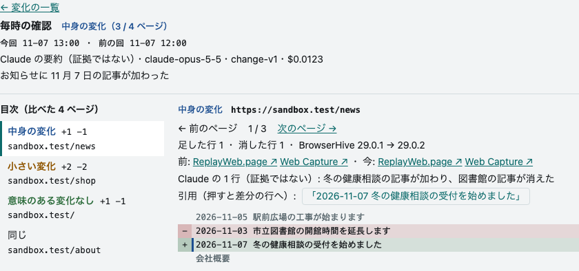

- **左に目次、右に 1 ページ。**
  目次は回で比べた全部のページで、重さの順（中身の変化・小さい変化・意味のある変化なし・要約の無い差分・差分を作れなかった）に並び、最後に前の回と同じだった「同じ」のページが並びます。
  開いた直後は目次の先頭のページを出します。
  目次の行と「← 前のページ」「次のページ →」は URL を書き換えるので、ブラウザの戻るで 1 つ前のページへ戻れ、URL を渡せば同じページが開きます。
  名指したページが回に無ければ（見てよくない WACZ・古い URL）、そう断って先頭のページを出します。
  狭い窓では目次が上、ページが下に並びます。
- **差分は証拠から作った物、要約は読みやすくしただけ。**
  差分は capture-ledger が 2 本の WACZ から Claude なしで作った物です。
  回の要約には「Claude の要約（証拠ではない）」と model・決まりの文の版・費用が、ページの Claude の 1 行には「（証拠ではない）」が付きます。
  確かめるときは「前:」と「今:」の後ろの 2 つの再生の link で 2 本を開きます。
- **引用を押すと差分の行へ。**
  Claude が引いた文を含む差分の行には左に印が付き、引用を押すとその行へ動きます。
- **「同じ」のページ。**
  前の回と同じ文字だったページです（空行と字下げだけの違いも入ります）。
  前と今の再生の link だけを出します。
  比べていないページ（片方の回にしか無い・伏せた・文字の digest が無い）は目次に出ません。
- **重さは 3 つ。**
  「意味のある変化なし」（時刻だけなど・緑）・「小さい変化」（宣伝の入れ替わりなど・琥珀色）・「中身の変化」（記事や事実が変わった・青）。
  決めるのは Claude で、誤りえます。
  差分は残るので、後から読めます。
- **差分に無い引用には印。**
  Claude が差分に無い文を引いたら「（差分に無い）」と赤で出します。
- **要約が止まったら帯に出る。**
  直近の回の要約が月の上限で止まったときと、3 回やり直して失敗したときです。
  中身の変化そのものでは帯を出しません。
- **見てよくない WACZ を含むページは出さない。**
  前と今の両方の WACZ を見てよいページだけが並びます。
- **開いたときに引く。**
  回は 1 日に数回しか変わらないので、ほかの一覧のように引き直しません。

## アーカイブ

見えている WACZ が、撮った時刻の新しい順に並びます。

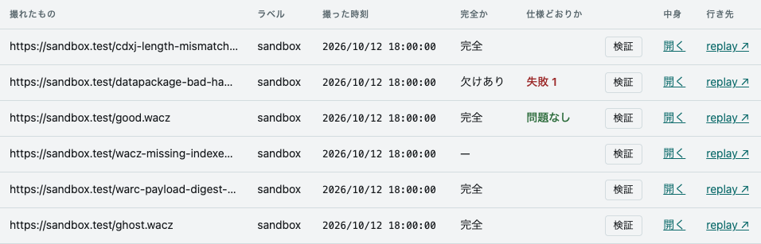

- **「完全か」の `—` は「分からない」。**
  capture-ledger の `waczComplete` が null の行で、「欠けあり」とは別です。
- **「検証」は、押したときだけ走る。**
  一覧を開くだけでは走りません。
  結果は行の「仕様どおりか」にも残るので、何本か見た後でも、押し直さずに思い出せます。
ページを読み直すと消えます。
  報告に何が出るかは [WACZ を見る](/wacz/)に書きました。
- **「開く」で WACZ の画面に入る**（`#wacz/<archiveId>`）。
- **「ReplayWeb.page ↗」と「Web Capture ↗」は、取り込んだ URL を replay で直に開く。**
  行き先は、サーバが `/healthz` で配る replayweb-server の origin、capture-ledger が返す `objectKey`、行の URL と撮った時刻から組みます（`#view=replay&url=…&ts=…`）。
  頁の script が動くので、JS で出す絵も出ます。BrowserHive が撮った DOM の写し（スクリプトの前と後）は、replay の Pages タブにあります。
  replay は自分では最初の頁を選びません。ページ一覧を日付の新しい順に並べ、WACZ の `mainPageURL` は読みません。
  開くのはその WACZ 1 本です。クロールのほかのページへリンクで行くなら、[クロール](#クロール)の画面の行の ReplayWeb.page ↗・Web Capture ↗ から開きます。

## 検索

capture-ledger の全文検索で、撮ったページの題と文字を探す画面です（`#search/<語>`）。

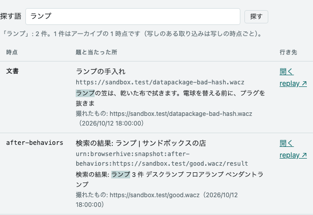

- **1 件はアーカイブの 1 時点。**
  capture-ledger は、WACZ のページ一覧の 1 行を索引の 1 件にします。
  写しの行がある WACZ では写しの行（`after-load`・`after-behaviors`）だけを、写しの無い取り込み（方針で伏せた文書など）は文書の行を入れます。
  同じアーカイブの検索前と検索後が両方当たれば、2 件並びます。
- **見せてよいアーカイブの物だけが並ぶ。**
  capture-ledger が、アーカイブの一覧と同じ認可で絞ります。
  件数は並んだ行の数で、capture-ledger が 1 回に返すのは 50 件までです。
- **「ReplayWeb.page ↗」と「Web Capture ↗」は、文書の行なら取り込んだ URL を、写しの行なら写しを直に開く。**
  文書の行は頁の script が動く形で、写しの行は script の無い DOM の写し（その時点の頁の姿）です。
- **「開く」で WACZ の画面に入る**（アーカイブの画面の一覧に在るアーカイブだけ）。
- **引くのは「探す」を押したときと、URL で開いたときだけ。**
  ほかの画面のような引き直しはしません。
- **capture-ledger の全文検索（OpenSearch）が要る。**
  答えないときは、理由を赤い 1 行で出します（capture-ledger の `CAPTURE_LEDGER_OPENSEARCH_URL` の先）。

## スクリプト集

撮るページの中で走らせるスクリプトを、JS にする前の TypeScript のまま読む画面です。自分のスクリプトを書く前の手本に、あるいはクロールが何を走らせたかを確かめるために。
左に一覧が 4 つの組で並びます。既定で走るもの（対象サイトの無いスクリプトの、有効な各 id の最新版。何も名指さないクロールが走らせる物）、サイト用のスクリプト（対象サイトのある物。起点がそのサイトのときだけ走る）、既定では走らないもの（有効な版の無いスクリプト。名指せば最新版が走る）、「書くための型」の `host.d.ts` —— 撮影のサーバがページに置く受け皿 `__bh` の型です。
型のほかは、[新しいクロール](#新しいクロール)の画面の「スクリプト」にもチェックとして並びます（既定では走らないものは外れた状態で）。
チェックの横の「読む」で、その画面の右の列でも読めます。

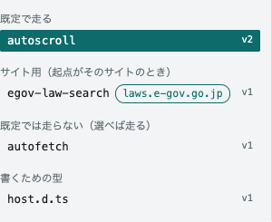

右には TypeScript が行番号つきで出ます。

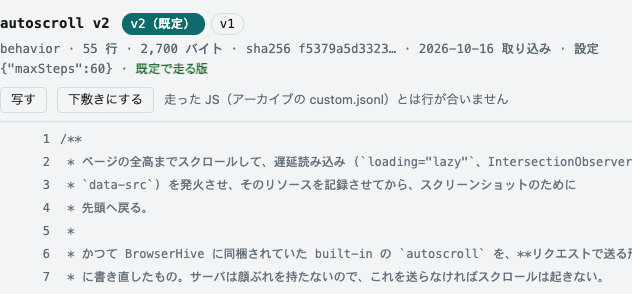

| URL | 開くもの |
| --- | --- |
| `#scripts` | 一覧の頭（URL はそれを名指す形に替わる） |
| `#scripts/autoscroll` | いま既定で走る版（既定では走らないスクリプトは最新版） |
| `#scripts/autoscroll@1` | 版 1（有効でも無効でも） |
| `#scripts/autoscroll@1:33` | 版 1 の 33 行に印を付け、窓の真ん中に出す |
| `#scripts/types/host.d.ts` | 受け皿 `__bh` の型 |

- **見出しが、読んでいる版を言う。**
  版のリンクにその id の版が全部並び、既定の版には「既定」、無効な版には「無効」が付きます。
  その下に、行数・大きさ・sha256 の先頭・取り込んだ日・渡す設定（`{}` はコードに書いた既定のまま）・既定で走る版かどうかが出ます。
  サイト用のスクリプトなら名前の横に対象サイトが付き、既定の版は「起点に laws.e-gov.go.jp があれば既定で走る版」と言います。無効な版は「無効（既定では走らない）」です。
- **対象サイトは、決まったサイトの頁でだけ意味のあるスクリプトの印。**
  対象サイト（`sites`）はホスト名の列で、[capture-scripts](https://github.com/uraitakahito/capture-scripts) の `catalog.json` に書き、capture-ledger が版ごとに持ちます。
  対象サイトのあるスクリプトは、クロールの起点のどれかがそのホストにあるときだけ既定で走ります。
  決まりはクロールの単位なので、リンクを辿って別のホストへ出た頁でも走ります。スクリプトは冒頭でホスト名を見て、ほかの頁では何もせずに終わります。
- **行を押すと、その行が URL になる。**
  人にそのまま渡せます。ブラウザの履歴は増えず、画面も描き直しません。
- **「写す」で source をクリップボードへ。**
  「下敷きにする」は、[新しいクロール](#新しいクロール)の画面へ、その場の TS として持って行きます。
- **source に色が付く。**
  色付けは [Shiki](https://shiki.style)（VS Code と同じ TypeScript の文法）で、配色は画面の明暗に合わせて GitHub Light High Contrast か GitHub Dark Default です（画面の地の上で、どの色も読める濃さを保つ組）。
  行は先に 1 色で出て、色は少し後から来ます。色付けは画面を描く thread の外（worker）で走るので、長いファイルでもすぐに読めて、流せます。
  印を付けた行は 1 色のままです。色を読み込めないときは本文の上の 1 行で言い、本文は 1 色のまま読めます。
- **行は TypeScript の行です。**
  クロールが走らせるのは変換後の JavaScript で、アーカイブの `behaviors/custom.jsonl` に残るのもそちらです。行は所々で数行ずれます。
- **クロールの「読む」は、そのクロールが走らせた版を開く。**
  sha256 の先頭も一緒に運びます。版の番号は使い回されることがある（最新の版を消して足し直すと、同じ番号が別の中身になる）ので、中身が違えば本文の上で言います。
- **取るのは、開いたものだけ。**
  一覧はいつもの引き直しの答えから作り、変わったときだけ描き直します。版の並びと中身は開いたときに、受け皿の型は画面を最初に開いたとき 1 回だけ取ります。
  読み取りのエンドポイントは capture-ledger の `GET /api/scripts/:id/versions`・`GET /api/scripts/:id/versions/:version`・`GET /api/host-types`（v0.60.0 から。対象サイトは v0.61.0 から。一覧の `GET /api/scripts` に既定では走らないスクリプトが `enabled: false` で載るのは v0.64.0 から）で、[workbench の素通し](/routes/)を通ります。

**登録済みのスクリプトが無ければ、赤で言います。**
撮影のサーバ（BrowserHive）は走らせるものを自分では持たないので、登録済みのスクリプトが無いと、ページの中で何も走りません。
スクロールも遅延読み込みも起きないまま、それでも取り込みは成功し、アーカイブも出ます。
赤い文の中に、[capture-ledger](https://github.com/uraitakahito/capture-ledger)（クロールを始め、撮れたものを記録するシステム）で取り込むコマンドが出ます。

## 引く間隔

走行中のクロールが 1 本でもあれば 2 秒ごと、無ければ 30 秒ごとに、一覧を引き直します。
終わったクロールが最後の合本の版を待つ間（終わってから 1 分まで）も、2 秒ごとのままです。
検索の画面と変化の画面は引き直しません（探したとき・開いたときだけ引きます）。
定期実行の予定は別の輪で引きます。
ふだんは 30 秒ごとで、順番待ちと走行中の間は 5 秒ごとです。
別の輪にしているのは、予定を読めないときにクロールの表まで止めないためです。
写しを持たなくても、走っている間は live に見えます。
動いていないときは黙ります。

取りに行けなかったときは、最後に描けた表を残したまま、画面の上に理由を出します（[クイックスタート](/quickstart/)の「出た文から直す」）。
