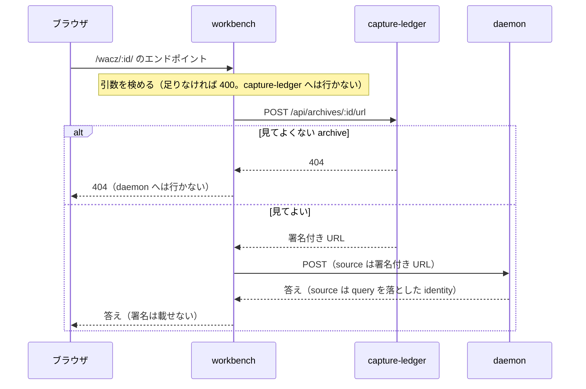

アーカイブの行からは、2 つのことができます。
「検証」で撮れたものが WACZ（撮ったページを 1 つの ZIP にまとめたアーカイブ）の仕様どおりかを確かめ、「開く」で WACZ の中身に入ります。
どちらも [wacz-validator](https://github.com/uraitakahito/wacz-validator)（WACZ を規則ごとに検証する検証器）の daemon が答えます。
capture-workbench は、capture-ledger に署名してもらった URL を daemon に渡すだけです。

## 先に capture-ledger へ訊く

どのエンドポイント（HTTP の method と path の組）も同じ 2 段です。
capture-ledger に署名をもらい、その URL を daemon に渡します（一覧は[エンドポイント](/routes/)のページ）。

- **鍵はどこにも増えない。**
  渡すのは capture-ledger が署名した URL 1 本で、daemon は store の資格情報を持ちません。
- **順番に意味がある。**
  先に capture-ledger へ訊くので、見てよい archive でなければ 404 になり、daemon までは行きません。
  絞るのは、認可を持っている側です。
- **署名付き URL は、ここから外に出さない。**
  応答にも、ログにも、失敗の文にも載せません（daemon が URL 入りの例外を投げても、`(signed URL)` に伏せます）。
  載せると、認可で閉じた意味が消えます。期限の内なら、URL を持つ者は誰でも読めるからです。
  報告に載る `source` は daemon が query を落とした identity なので、そのまま返してよいものです。
- **署名は、エンドポイントを呼ぶたびに取り直す。**
  取っておくと、workbench が有効な鍵を持ち続けることになります。

## 検証の報告

アーカイブの行の「検証」を押すと、その 1 本の報告が行の下に開きます。

- 合格の数と、結論（失敗 N ／ 警告 N ／ 問題なし）。
  合格だけを見せないのは、警告 0 と警告 3 は別の状態で、どちらも「失敗 0」だからです。
- どの build の検証器が、どの profile で見たか（`wacz-validator <版>` ／ `profile <名前>`）と、かかった時間。
  WARC（撮った要求と応答を順に記録するファイル）のレコード数と host は、報告に統計が在るときだけ出ます（統計は best-effort で、壊れた WACZ では無いことがあります）。
- rule ごとの指摘。
  severity・rule の名前・message と、仕様へのリンク（「仕様 ↗」）。
- ZIP の entry の一覧。
  在るべきなのに無い entry は「無い」と出ます。

結果は、行の「仕様どおりか」にも残ります（ページを読み直すと消えます）。

**報告の文は 1 つも持たない。**
message も、仕様へのリンクも、daemon が解決して返したものをそのまま出します。
workbench が rule を言い換えると、検証器が言い始めたことと静かにずれていくからです。
workbench が渡すのは `locale`（画面の言語。`ja` か `en`）だけで、daemon はその言語の文で答えます（英語の画面では、報告は英語です）。

### spec profile で見ている

workbench は profile を渡さないので、daemon は既定の `spec` で検証します。
撮影のサーバ（BrowserHive）に限った rule は、workbench には出ません。
報告の行に `profile spec` と出るので、どの profile で見たかは画面で分かります。
BrowserHive の規定で見たいなら、workbench から profile を渡す手段が要ります（いまは無い）。

### daemon は自分では建て直らない

wacz-validator を出しても、動いている daemon は起こしたときの build のまま動き続けます。
古いまま動いていれば、報告に出る版で分かります。
[capture-ledger](https://github.com/uraitakahito/capture-ledger)（クロールを始め、撮れたものを記録するシステム）の `pnpm run dev:status` も、動いている build を checkout と比べて言います。
起こし直すのは、capture-ledger で `pnpm run dev:up --from validator` です。

## WACZ の画面

アーカイブの行の「開く」で、その 1 本の画面に入ります。
URL は `#wacz/<archiveId>` で、選んだ entry と行まで載ります（`#wacz/<archiveId>/indexes%2Findex.cdxj:66` のように指せます）。

開くと検証が走り、左の木は報告の entry の一覧から組みます。
wacz-validator の端末の画面（`@wacz-validator/tui`）と、同じ入力・同じ罫線です。
右には、選んだ entry の詳細（大きさ・STORE か DEFLATE か・仕様のどこが求めるか・その entry への指摘）と中身が出ます。

- **行**: 200 行ずつの窓です。
  長い行は横で切ります。
  続きがあれば「続きを読む」が出ます。
- **1 行**: 行を押すと、その行を丸ごと読みます（大きすぎる行は daemon が切り、「4 MiB で切った」と出ます）。
  CDXJ（WARC の索引の形式）と JSONL（1 行に 1 つの JSON）は、daemon が field に割って返します。
  workbench は割り方を持ちません。
  索引の行なら「このレコードを開く」が出ます。
- **レコードの一覧**: `.warc.gz` を選ぶとこちらです。
  WARC を頭から歩いた 1 件 1 行で、200 件ずつ読み、種別で絞れます。
  ▪ は索引（CDXJ）が指すレコード、▫ は索引に無いものです。
  BrowserHive が残す「撮らなかった・撮れなかった」記録（`WARC-Type: metadata`）は、ここでしか見えません。
  種別の「写し」（`WARC-Type: resource`）は、BrowserHive が読み込みの後と、スクリプトを走らせた後の取り込みのページを DOM のまま写した物で、サーバの応答ではありません（組の「記録」がそう言います）。
  BrowserHive v30.2.0 からは、節目のスクリーンショット（同じ 2 つの時点の viewport の絵）も同じ `WARC-Type: resource` のレコードなので、一覧では同じ「写し」の名前で出ます。
  見分けるのは URI で、DOM の写しは `urn:browserhive:snapshot:`、節目のスクリーンショットは `urn:browserhive:screenshot:` で始まります。
  一覧の上には、その WARC の warcinfo（WARC が自分自身を説明するレコード）の欄を、書かれた順に出します。
  欄の名前が Dublin Core の語か WARC 1.1 の warcinfo の欄なら、3 列目にそう出て、その定義へリンクします。
  どちらでもない名前（作り手が決めた名前）は空です。
  見分けるのは wacz-validator で、workbench は検証の報告の `warcinfo` を描くだけです。
- **1 レコード**: WARC の見出し、HTTP の状態行と見出し、本文です。
  本文は文字か、raster の画像か、大きさだけです。

WACZ の画面の中で entry や行を選んでも、URL を書き換えるだけで、検証はやり直しません。
別の archive を開いたときだけ、検証し直して木を組み直します。

## 撮った中身は他人が書いたもの

WACZ の中身は、撮ったページの作者が書いたものです。
workbench は、文字を `textContent` で入れ、画像は raster だけを `` で出します。
daemon は画像に `nosniff` と `sandbox` を付け、SVG と HTML は 415 で断ります。
生の HTML を差し込む API は workbench に無く、`npm run check` が `public/` の JS に `innerHTML` が無いことを見張っています。
