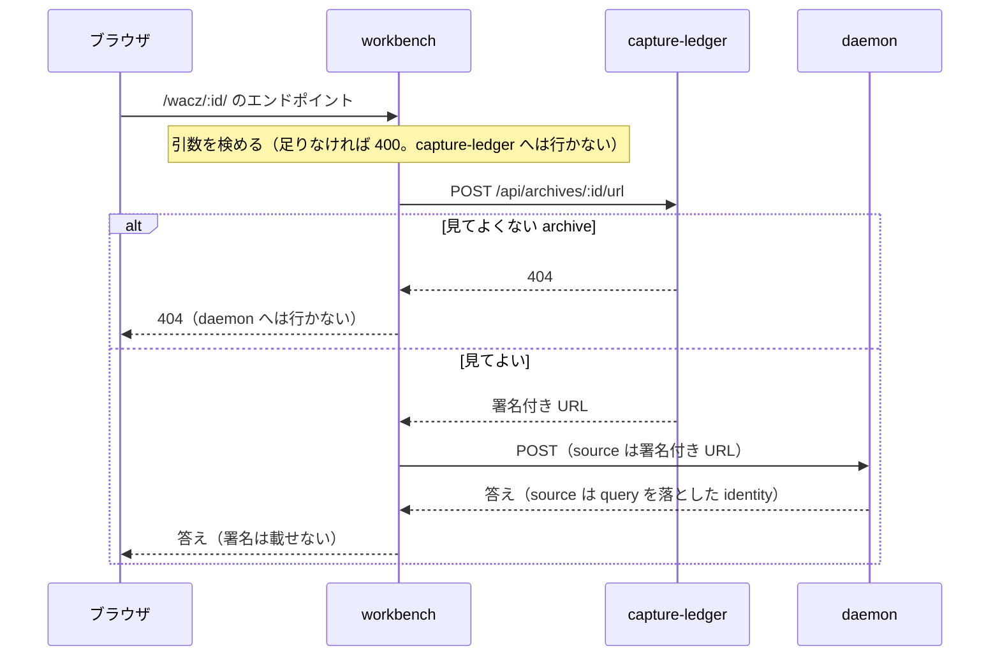

アーカイブの行からは、2 つのことができます。
「検証」で撮れたものが WACZ（Web Archive Collection Zipped）1.1.1 どおりかを rule ごとに確かめる画面に入り、「開く」で WACZ の中身に入ります。
どちらも [wacz-validator](https://github.com/uraitakahito/wacz-validator)（WACZ を規則ごとに検証する検証器）の daemon が答えます。
capture-workbench は、capture-ledger に署名してもらった URL を daemon に渡すだけです。

## 先に capture-ledger へ訊く

どのエンドポイント（HTTP の method と path の組）も同じ 2 段です。
capture-ledger に署名をもらい、その URL を daemon に渡します（一覧は[エンドポイント](/routes/)のページ）。

- **鍵はどこにも増えない。**
  渡すのは capture-ledger が署名した URL 1 本で、daemon は store の資格情報を持ちません。
- **順番に意味がある。**
  先に capture-ledger へ訊くので、見てよい archive でなければ 404 になり、daemon までは行きません。
  絞るのは、認可を持っている側です。
- **署名付き URL は、ここから外に出さない。**
  応答にも、ログにも、失敗の文にも載せません（daemon が URL 入りの例外を投げても、`(signed URL)` に伏せます）。
  載せると、認可で閉じた意味が消えます。期限の内なら、URL を持つ者は誰でも読めるからです。
  報告に載る `source` は daemon が query を落とした identity なので、そのまま返してよいものです。
- **署名は、エンドポイントを呼ぶたびに取り直す。**
  取っておくと、workbench が有効な鍵を持ち続けることになります。

## 検証の画面

アーカイブの行の「検証」を押すと、その 1 本の検証の画面に入ります。
URL は `/check/<archiveId>`（もう 1 つの profile では `/check/<archiveId>/browserhive`）なので、結果をリンクで人に渡せます。
画面に入ると 1 度検証します。同じアーカイブと profile に戻ったときは、取った答えをそのまま出し、「検証し直す」で取り直します。

- **結論は rule で数えます。**
  落ちた rule N ／ 警告の rule N ／ 問題なし。
  info だけを出した rule と、走らせなかった rule は、結論を赤や黄にしません。
  隣の帯は、全部の rule を結果ごとに数えます（落ちた・警告・info だけ・通った・見なかった・本数）。
  報告の `summary` は読みません。`passed` は rule の数、`failed` は指摘の数で、足しても合わないからです。
- どの build の検証器が、どの profile で見たか（`wacz-validator <版>` ／ `profile <名前>`）と、かかった時間。
  WARC（撮った要求と応答を順に記録するファイル）のレコード数と host は、報告に統計が在るときだけ出ます（統計は best-effort で、壊れた WACZ では無いことがあります）。
- **rule ごとに 1 行で、範囲ごとに束ねます**（`wacz/`・`datapackage/`・`cdxj/`・`pages/`・`warc/`・`browserhive/`。検証器が登録した順）。
  束の中は、落ちた・警告・info だけ・通ったの順です。
  1 行には、印（✕ ! i ✓）・rule の名前・仕様が MUST か SHOULD か・rule が何を見るか・指摘の数が並びます。
  落ちた rule と警告の rule は最初から開いています。どの行も押すと開きます。
- **開いた行には指摘が出ます。**
  severity・message・場所・仕様の節へのリンク（「仕様 ↗」）・rule が付けた詳しい物（JSON）と、rule の出典です。
  entry と行の分かる場所は、[WACZ の画面](#wacz-の画面)のその行へのリンクです。WARC の中の byte の位置は、字で書くだけです（WACZ の画面に、位置で開く URL が無いため）。
- **走らせなかった rule は、下に畳んであります**（見なかった rule）。profile が外す rule と、producer の版の条件で見なかった rule です。
- **中のファイルは、その下に畳んであります。**
  欠けたファイルと指摘のあるファイルに印が付きます。木で見るなら「WACZ の画面で開く」。

結論は、アーカイブの行の「仕様どおりか」にも、画面へ戻るリンクとして残ります（ページを読み直すと消えます）。`browserhive` の結論には profile の名前が付きます。

**報告の文は 1 つも持たない。**
rule が何を見るかも、message も、仕様へのリンクも、daemon が解決して返したもの（報告の `rules` と `issues`）をそのまま出します。
workbench が rule を言い換えると、検証器が言い始めたことと静かにずれていくからです。
workbench が渡すのは `locale`（画面の言語。`ja` か `en`）と `profile` だけで、daemon はその言語の文で答えます。

### profile を選ぶ

画面には `spec` と `browserhive` の 2 つの button があります。
`spec`（既定。daemon の既定と同じ）は、仕様が求めることを見ます。
`browserhive` は、その上に [BrowserHive WACZ Profile](https://uraitakahito.github.io/browserhive-specs/wacz-profile/1.28.0/ja/) が求めることを見ます。
`spec` では、BrowserHive の rule は「見なかった rule」に並びます。
workbench は WACZ を作った BrowserHive の版を渡さないので、`browserhive` では、古い BrowserHive が作った WACZ が、後から足した rule で落ちることがあります。

### rule ごとの結果の無い報告

rule ごとの結果（`rules`）は、wacz-validator v0.52.0 からの報告に載ります。
それより古い daemon は載せずに答えるので、画面は報告を別の形で描かずに「daemon が古い」と言い、建て直しの命令（下）を出します。

### daemon は自分では建て直らない

wacz-validator を出しても、動いている daemon は起こしたときの build のまま動き続けます。
古いまま動いていれば、報告に出る版で分かります。
[capture-ledger](https://github.com/uraitakahito/capture-ledger)（クロールを始め、撮れたものを記録するシステム）の `pnpm run dev:status` も、動いている build を checkout と比べて言います。
起こし直すのは、capture-ledger で `pnpm run dev:up --from validator` です。

## WACZ の画面

アーカイブの行の「開く」で、その 1 本の画面に入ります。
URL は `/archive/<archiveId>` で、選んだ entry と行まで載ります（`/archive/<archiveId>/indexes%2Findex.cdxj:66` のように指せます）。

開くと検証（`spec` の profile）が走り、左の木は報告の entry の一覧から組みます。
上の帯には、検証の画面と同じく rule で数えた結論と、検証の画面へのリンク（「検証の画面で見る」）が出ます。
wacz-validator の端末の画面（`@wacz-validator/tui`）と、同じ入力・同じ罫線です。
右には、選んだ entry の詳細（大きさ・STORE か DEFLATE か・仕様のどこが求めるか・その entry への指摘）と中身が出ます。

- **行**: 200 行ずつの窓です。
  長い行は横で切ります。
  続きがあれば「続きを読む」が出ます。
- **1 行**: 行を押すと、その行を丸ごと読みます（大きすぎる行は daemon が切り、「4 MiB で切った」と出ます）。
  CDXJ（WARC の索引の形式）と JSONL（1 行に 1 つの JSON）は、daemon が field に割って返します。
  workbench は割り方を持ちません。
  索引の行なら「このレコードを開く」が出ます。
- **レコードの一覧**: `.warc.gz` を選ぶとこちらです。
  WARC を頭から歩いた 1 件 1 行で、200 件ずつ読み、種別で絞れます。
  ▪ は索引（CDXJ）が指すレコード、▫ は索引に無いものです。
  BrowserHive が残す「撮らなかった・撮れなかった」記録（`WARC-Type: metadata`）は、ここでしか見えません。
  [BrowserHive WARC](https://uraitakahito.github.io/browserhive-specs/wacz-profile/1.28.0/ja/#archive-files) の `WARC-Type: resource` のレコードは 3 種類で、一覧は URI の頭で呼び分けます。
  種別の「写し」（URI が `urn:browserhive:snapshot:` で始まる）は、BrowserHive が読み込みの後と、スクリプトを走らせた後の取り込みのページを DOM のまま写した物で、サーバの応答ではありません（組の「記録」がそう言います）。
  種別の「枠の写し」（URI が `urn:browserhive:frame-snapshot:` で始まる。BrowserHive v31.2.0 から）は、同じ時点に、取り込みのページの同じ origin の子フレーム（`<iframe>`・`<frame>`）の文書を写した物です。URI は `urn:browserhive:frame-snapshot:<時点>:<番号>:<子の文書の URL>` の形で、番号はその時点のフレームの順です（[BrowserHive WARC Profile 1.5.0](https://uraitakahito.github.io/browserhive-warc-spec/1.5.0/ja/#frame-snapshots)）。
  種別の「節目の絵」（URI が `urn:browserhive:screenshot:` で始まる。BrowserHive v30.2.0 から）は、節目のスクリーンショット（同じ 2 つの時点の viewport の絵）です。
  頭がどれでもない resource のレコードは、WARC-Type の名前のまま「resource」と出ます。種別の絞りも、4 つを別々に数えます。
  一覧の上には、その WARC の warcinfo（WARC が自分自身を説明するレコード）の欄を、書かれた順に出します。
  欄の名前が Dublin Core の語か WARC 1.1 の warcinfo の欄なら、3 列目にそう出て、その定義へリンクします。
  どちらでもない名前（作り手が決めた名前）は空です。
  見分けるのは wacz-validator で、workbench は検証の報告の `warcinfo` を描くだけです。
- **1 レコード**: WARC の見出し、HTTP の状態行と見出し、本文です。
  本文は文字か、raster の画像か、大きさだけです。

WACZ の画面の中で entry や行を選んでも、URL を書き換えるだけで、検証はやり直しません。
別の archive を開いたときだけ、検証し直して木を組み直します。

## 撮った中身は他人が書いたもの

WACZ の中身は、撮ったページの作者が書いたものです。
workbench は、文字を `textContent` で入れ、画像は raster だけを `` で出します。
daemon は画像に `nosniff` と `sandbox` を付け、SVG と HTML は 415 で断ります。
生の HTML を差し込む API は workbench に無く、`npm run check` が `public/` の JS に `innerHTML` が無いことを見張っています。
