capture-workbench is a set of views you switch with the tabs at the top, and the `#` in the URL decides
which view is shown (`#crawls`, `#start`, `#schedules`, `#changes`, `#archives`, `#search`, `#scripts`; in the search view it also
names the words searched, in the changes view the run and page opened, and in the script collection view what you are reading). The WACZ tab only appears once you
enter it with **Open** (開く) on an archive row. The tabs are **Crawls** (クロール), **New crawl**
(新しいクロール), **Schedules** (定期実行), **Changes** (変化), **Archives** (アーカイブ), **Search** (検索),
**Script collection** (スクリプト集) and WACZ.

The workbench comes in Japanese and English. You switch at the top right, and until you do, the
browser's language decides ([Language](#language)). This page uses the words of the English screen.
**The pictures on this page were taken on the Japanese screen**, so where a label first comes up, the
Japanese that the pictures show follows in parentheses, and the notes under a picture name what is
in it in Japanese.

The pictures on this page are taken against the stand-in ledger (the
[sandbox](/development/#opening-the-workbench-in-the-sandbox)). Its scripts are copies from capture-scripts,
the same ones a real ledger lists; only autoscroll v2 is the stand-in's own version, there to show version chips.

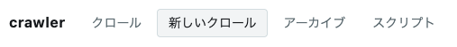

| View | What it lists |
| --- | --- |
| Crawls | one row per crawl: state, pages captured, links, number of WACZ files (the archive format that packs captured pages into one ZIP), time taken, links to the run and to replayweb-server (the whole crawl as one archive) |
| New crawl | the form that starts a crawl: seed URLs, registered scripts, depth, the values of the variables the ticked scripts declare, and a script of your own in a box as tall as the window; a registered script can be read in a tab of the right column |
| Schedules | schedules and their runs; pause, resume, run now, repin and delete a schedule. A run that did not capture shows on a band on every view |
| Changes | how a scheduled run differs from the previous one — one line per run; an opened run lists every page on the left and shows one page on the right: the diff, Claude's line (not evidence) and ReplayWeb.page ↗ / Web Capture ↗ for before and after |
| Archives | the WACZ files you can see; from a row, validate, open it in the WACZ view, or open in [replayweb-server](https://github.com/uraitakahito/replayweb-server) (which plays a WACZ back in the browser) |
| Search | the ledger's full-text search: type words, and the matching stages of archives (the document or a snapshot) are listed; from a row, open the WACZ view or replayweb-server |
| Script collection | the scripts that run inside the captured page and the types they are written against, to read line by line, older versions too; says so in red when the ledger has none |
| WACZ | inside one WACZ; see [Inspecting a WACZ](/wacz/) |

The top of the screen says who you are signed in as (`Signed in as <user> (<groups>)`), with a
**Sign out** (サインアウト) link and the language switch next to it. The footer shows how many rows are listed and how often the lists are fetched again.

## Language

The workbench is in Japanese and English. The words on the screen come from one dictionary per
language ([Development](/development/#the-text-on-the-screen)).

- **The switch is at the top right, next to Sign out:** 日本語 / English. The language in use
  cannot be pressed. Pressing the other one remembers the choice in the browser (`localStorage`,
  under `workbench.lang`), takes `?lang=` off the URL and reloads the page. If the new crawl view
  holds something you have written (seed URLs, your script or its name, the User-Agent, a
  variable's value, a schedule's name), it asks first, because reloading loses it.
- **The language is decided when the page loads,** in this order: `?lang=ja` or `?lang=en` in the
  URL (for that load only; the remembered choice stays as it was), the choice the switch
  remembered, the first of the browser's languages that is Japanese or English, and English when
  none of them says. A browser that will not store the choice gets it carried in `?lang=`
  instead.
- **Some text is not translated.** What was stored, or written by capture-ledger, BrowserHive,
  Windmill or the daemon as data, is shown as it arrived (states such as `captured`, step names,
  log lines, the failure reason kept with a crawl or with a schedule's run), and so are proper
  names. What capture-ledger says when it refuses a request is different: its phrase and its
  reasons are shown in the screen's language when the workbench's dictionary has them, and as
  they arrived when it does not (an answer from a ledger newer than the workbench, the text of a
  schema check, a command to run). Claude's summaries in the changes view are in Japanese, because
  capture-ledger had them written in Japanese; on the English screen the view adds
  `The summary is written in Japanese.`
- **The validation report follows the screen.** The workbench hands the screen's language to the
  daemon, so validating an archive on the English screen returns an English report
  ([Inspecting a WACZ](/wacz/#the-validation-report)).

## The lists are one page of the ledger

The crawls and archives views list only the first page the ledger returns (newest first). The
workbench does not fetch further pages. For archives, the ledger returns only the ones in that page
that your identity may view, so there can be fewer rows than a page holds. The counts in the
footer are the rows on screen, not everything the ledger has.

The **Pages** (ページ) table of an opened crawl, the list of the pages the ledger recorded for it, also
starts with the one batch the ledger returns. Further pages are fetched only when you press **Read on** (続きを読む), and
what you have read stays listed when the table is fetched again.

## Crawls

Each row is one crawl. It shows the state (**State**, 状態), the first 8 characters of the id, who
started it and for which organization (**Started by**, 始めた人), the seed URL (**Seed**, 起点),
pages captured (**Captured**, 撮れた), links (**Links**, リンク), the number of WACZ files and the time
taken (**Time taken**, かかった). Under **Open in** (行き先) at the right end, "run ↗" opens the Windmill run in a new tab, and
"ReplayWeb.page ↗" and "Web Capture ↗" next to it open the whole crawl in replay as one archive, once the ledger has written
the crawl's bundle.

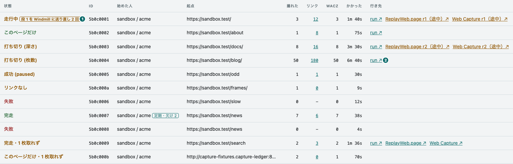

① state\
② the link to the run

- **The seed URL takes two lines.** The top line is the path and query, and the bottom line, in
  smaller type, is the origin (scheme, host and port); the two together are the URL. A seed whose
  path is only `/` (such as `https://laws.e-gov.go.jp/`) is told apart by its host, so it shows the
  whole URL on one line. A line that does not fit ends in "…"; hover over the cell to read the whole
  URL. A crawl with more than one seed shows the first one followed by how many more there are
  (such as `+5`), and hovering lists every seed, one per line.
- **Pages captured and links are separate columns.** The links column (`pagesDiscovered`) is the
  number of distinct URLs the rules let through among the links on the captured pages (seeds are
  not counted). URLs that were not captured count too, so it is not the denominator of pages
  captured. A crawl of depth 0 counts them as well; it just does not follow them. Clicking the
  number opens the crawl's [link structure](#link-structure). A crawl from before the ledger kept
  every link (before v0.99.0) still shows the per-level sum, which counts a URL twice when two
  levels find it; that number is muted and says so on hover. A depth-0 crawl started before
  capture-ledger v0.83.0 did not count them, so it shows 0.
- **A row with no captured pages shows `−` for links.** There was no page to count, so it does
  not claim there were 0 links.
- **For a running crawl, the time taken is "so far".** A missing finish time means "not finished
  yet", not "no time".
- **run ↗ is the run of the last level that was handed over.** The link is built from the id of
  `lastJob` that the ledger returns, plus the Windmill origin and workspace the server hands out
  through `/healthz`. Rows where the ledger has no `lastJob` get no link.
- **When a level was sent to Windmill again, the state says so.** When capture-ledger cannot
  confirm that Windmill took a level, it sends it again with the same level key (CAPTURE-180). If
  the newest level was sent twice or more, or a last error is left, the state cell gets a mark such as
  `Level 1 sent to Windmill again 3 times` (段 1 を Windmill に送り直し 3 回), and hovering the mark
  shows the last error. A level given up after 10 minutes is red:
  `Level 1 could not be handed to Windmill, given up after 21 sends` (段 1 を Windmill に渡せず諦めた（21
  回送った）). A level taken at the
  first send shows nothing. The numbers come from the ledger's `dispatch` (the newest level's
  `attempts` and `lastError`); the resends are the sends minus one.
- **ReplayWeb.page ↗ / Web Capture ↗ open the crawl as one archive.** After each level, the ledger writes the crawl's
  bundle (合本) to the store: a `replay.json` that lists every WACZ file of the crawl, and the
  index of its pages (`pages.json`) that replayweb-server answers from when ReplayWeb.page looks a page
  up. ReplayWeb.page opens them as one archive, so a link on a captured page leads to a page captured into
  another WACZ file.
  The link opens the list of pages (`#view=pages`) of the version the ledger points at
  (`replayBundle.key`), at the replayweb-server origin the server hands out through `/healthz`. A crawl with
  no bundle (nothing captured yet, or a ledger that writes none) gets no link. The ledger never
  stops a crawl over a bundle it could not write: an opened row says why first, in the ledger's
  words (`replayBundle.error`), and ReplayWeb.page ↗ / Web Capture ↗ keep opening the version written before, if there is
  one. The rules for these links are `replayBundleHref` in `public/replayweb.js`, pinned by
  `test/replayweb.test.mjs`.
- **A version written mid-crawl says so.** While a crawl runs, ReplayWeb.page ↗ / Web Capture ↗ open the version the
  ledger has written so far. Pages captured in later levels are not in it, so a link to one ends
  in Not Found in replay. The links therefore read `ReplayWeb.page r1 (mid-crawl) ↗` and `Web Capture r1 (mid-crawl) ↗` (`r1（途中）↗` in the picture above), in the warning
  color, with an explanation on hover. A finished row reads the same while the version it points at
  is older than the end of the crawl (`builtAt` before `finishedAt`): the flow runs `report` (the
  crawl ends here) before `replay_bundle` (the last version is written here), so the last version
  arrives slightly later. A row whose next version could not be written keeps opening the earlier
  one the same way. The pages table of an opened row keeps the texts "ReplayWeb.page ↗" and "Web Capture ↗" and only takes the
  color and the explanation. The rule is `isPartialBundle` in `public/replayweb.js`, pinned by
  `test/replayweb.test.mjs`.

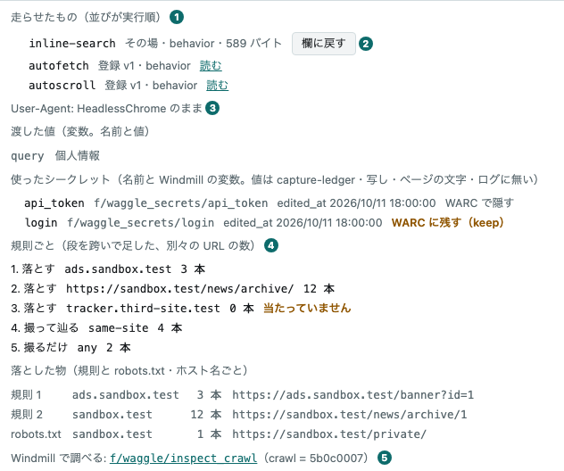

① what ran (in run order)\
② 欄に戻す (Back to the form)\
③ 渡した値 (Values passed), the variables, and 使ったシークレット (Secrets used)\
④ the count per rule\
⑤ Windmill で調べる (Inspect in Windmill), the link to inspect_crawl

- **Click a row to see why it failed, what ran in the page, which values it was given, and the
  URLs that could not be fetched.** Only then does the workbench fetch `/api/crawls/:id`. The ledger's
  `error` comes first, in its own words (a level sent to Windmill again comes even before it, with
  the count and the last error): a crawl that failed at the compile step captured nothing, so
  its list of failed pages is empty and would otherwise read like a success. Next is what ran, in the
  order it ran: registered scripts with their version and a **Read** (読む) link to the
  [script collection view](#script-collection) at the version the crawl ran, and scripts written in the form marked
  `your script` (その場) with their size in bytes, each with a **Back to the form** (欄に戻す) button that
  takes you to the [new crawl view](#start-a-crawl). A site script carries its sites, as a chip such as
  `for laws.e-gov.go.jp` (`laws.e-gov.go.jp 用`). Then come the values: the variables the crawl was started with (the ledger's
  `variables`, name and value) and the secrets it used (`secrets`: the name, the path of the Windmill
  variable, its `edited_at` when the ledger checked that it existed, and whether its value stays in
  the WARC, `archive`). A secret's value never appears: only Windmill holds it, the ledger does not,
  and it is gone from the snapshots, the page text and title, and the logs. What the WARC keeps is
  up to the declaration. A secret marked **Hidden in the WARC** (WARC で隠す) had its value replaced by
  `***` in the [BrowserHive WARC](https://uraitakahito.github.io/browserhive-specs/wacz-profile/1.25.0/#archive-files), whether the script put it on the wire or the site sent it back. **Kept in the WARC (keep)**
  (WARC に残す（keep）) is a secret declared with `archive: "keep"`: its value stays as it is in the
  record of the traffic (the WARC's request, response and metadata records, and their URLs). In the
  picture above `api_token` is hidden and `login` is kept (crawl `5b0c0007` of the stand-in's
  scenario). Hiding started with BrowserHive v29.0.0: in a capture made before it, a value put on the
  wire is still in the WARC, yet the ledger answers `archive: null` for those rows too, so they read
  **Hidden in the WARC** (the mark says so when the pointer rests on it). If the Windmill variable was
  rewritten while the crawl ran, the row says from which level. Above them is the `User-Agent` the crawl
  asked for, as typed, or `User-Agent: still HeadlessChrome` (HeadlessChrome のまま). A crawl that asked to record
  random values (ledger v0.105.0) adds `Recorded random values` (乱数を控えた) under it; one that did not adds nothing. A crawl given nothing reads
  `Values passed: none` (渡した値: なし), and a row from an older ledger without values shows nothing here. Last
  are the pages that failed, the latest 5 that the ledger returns (the state column gives the total); if none did, it says so and lists the seed
  URLs.
- **A crawl that failed the type check shows all of its type errors, and can ask for a fix.** When the
  ledger's `error` says the compile step failed with a 422, the workbench also fetches
  `/api/crawls/:id/diagnostics`: the ledger sends the crawl's scripts to ts-compile-service again, and
  the table lists every error with its script, line and column, code and message (the `error` is cut
  at the ledger's limit and names only the first few). The table does not call Claude. An inline
  script with errors gets **Ask for a fix** (直し方を訊く) next to **Back to the form**: only pressing it calls Claude,
  through the ledger, which returns a fix only if it passes the same check. The answer shows the
  reasons, the replaced lines (removed and added, with line numbers), the rounds and the cost, and
  **Put the fixed version in the form** (直した版を欄に戻す), which works like **Back to the form** with the fixed
  source (the name and phase stay as they were). Only the types were checked: read the diff, and
  capture once to see that the script still does what it did. Any other answer (nothing to fix, no fix
  passed, this month's limit reached, a ledger without the route) is one line: the status and the
  ledger's phrase, in the screen's language when the dictionary has it and as it arrived when it does not.
  The reasons a fix was rejected are listed the same way.
- **An opened row also shows what the crawl's rules decided** (the ledger's
  `/api/crawls/:id/decisions`, fetched together with the detail). First, per rule, the distinct URLs it
  matched, counted per level and added up (a URL found on two levels counts twice); a rule that never matched is marked **Never matched** (当たっていません),
  since a rule that never fires usually does not say what its author meant. Then what was dropped,
  by host name: by a rule, by no rule, and the pages robots.txt kept the crawl from taking. A crawl
  that looked at no links says so in one line instead of listing rules that all show 0. Last is a
  link, **Inspect in Windmill** (Windmill で調べる), to the script `f/waggle/inspect_crawl` in Windmill
  with this crawl's id already filled in (Windmill keeps a run's arguments in the URL's hash).

① the outcome (the ledger's state and reason), with ReplayWeb.page ↗ / Web Capture ↗ for a page in the crawl's bundle\
② the warn and error counts\
③ ログ (Log): opens the page's log, and closes it on a second press\
④ the level filter

- **An opened row also lists the crawl's pages** (the ledger's `/api/crawls/:id/pages`, fetched
  together with the detail), after what the rules decided. They come in the order the ledger
  recorded them, each with its URL, its outcome, the number of warn and error lines in its log, and
  a **Log** (ログ) button. The outcome is the ledger's state (`captured`, `failed` and so on), not
  reworded, followed by the reason a page was skipped or failed, if any. The ledger keeps a page
  that never got a report as `pending` (whether it was captured is unknown), so in a crawl that has
  ended such a page reads `pending (no report: the crawl ended first)`
  (`pending（報告なし —— クロールが先に終わった）`) — a crawl that failed the type check captured nothing, and its seed would otherwise
  look like it is still waiting. A page that has a capture's answer (captured or failed) has **Trace**
  (経緯) after its outcome, which opens [that one capture's trace](#one-captures-trace). A page whose WACZ is in the bundle the ledger points at has
  ReplayWeb.page ↗ / Web Capture ↗ after its outcome: it opens that page inside the crawl's bundle, at the time it was
  captured (`#view=replay&url=…&ts=…`). What decides it is the ledger's `bundledRev`, the first
  version of the bundle that the page's WACZ went into: the link appears when it is no later than
  the version in the opened row's `replayBundle`. A page without a WACZ, a WACZ in no version yet,
  and a WACZ that went into a version newer than the one fetched with the row get no link. The
  warn and error counts are what the ledger counted in that capture's `.result.json`; a page whose
  counts the ledger has
  not read shows "—", which is not the same as 0. The table holds one batch from the ledger, with
  **Read on** when there is more. A ledger without the pages route gets a one-line note.
- **Log shows the log lines of that page.** The workbench fetches the ledger's
  `/api/crawls/:id/pages/:page/log` once, when you press it (closing and opening again fetches
  again). The lines come in the order they arrived: the milliseconds since the capture started, the
  source (`script` and the script's id for a script's lines, `page` for the captured page's console
  and exceptions, `browserhive` for BrowserHive's own lines), the level, the message and the data.
  BrowserHive attaches whose line it is, so a script never writes its id. Messages are not reworded,
  and the data follows the message as JSON. The filter starts at **All** (すべて), and offers **warn and above**
  (warn 以上) and **error only** (error だけ); its numbers are how many lines each one shows. A line
  BrowserHive cut at its per-line limit is marked `cut short` (途中で切った), and when lines were
  not kept, the box says how many (`N lines not kept (by the limit or a policy)`, N 行は残していない（上限か方針で）):
  lines dropped over the limit for the capture, and lines a document withheld by a policy wrote to its
  console. A browserhive line in the log says which. For a page whose log
  cannot be read, the box gives the ledger's reason, as a short sentence and the reason itself (not
  captured yet or not captured, no `.result.json` recorded, missing from the store or not matching
  the contract, or captured by a BrowserHive from before logs were kept).
  When the page has a WACZ, **Open in the WACZ view** (WACZ の画面で開く) above the box opens the same
  lines sealed in the [BrowserHive WACZ](https://uraitakahito.github.io/browserhive-specs/wacz-profile/1.25.0/) (`logs/capture.jsonl`) in the WACZ view. A WACZ line is the answer's line
  with `profile` added, and the signature covers it. A BrowserHive WACZ from before BrowserHive WACZ
  Profile 1.19.0 has no such entry.
- **An opened row stays open.** The table is rebuilt on every fetch, so the workbench remembers the
  open rows by id and opens them again from the last answer. It fetches a row again only while the
  crawl is running or when its state has changed. Opened logs are remembered by page id too, and
  their boxes are moved rather than rebuilt, so they keep their scroll position and filter. They are
  forgotten when you close the row or when the crawl leaves the list.

### Link structure

Clicking the links number on the list opens that crawl's link structure (the URL is
`#links/<crawl id>`). The tab stays **Crawls**; the view replaces the list, and **← Crawl list** (← クロールの一覧) goes
back. The numbers and outcomes are what the ledger kept, one row per link, at each level report
(`GET /api/crawls/:id/links`); the workbench only draws them.

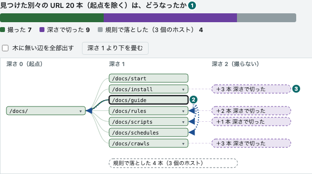

① the bar of what became of the URLs\
② the selected page (its links are listed below)\
③ a box of links that were not captured

- **The bar on top says what became of the distinct URLs the crawl found.** Its parts are
  **Captured** (撮った), **Not captured (failed or skipped)** (取れず・見送り), **Pending** (これから),
  **Cut by the page limit** (枚数で切った), **Cut by the depth limit** (深さで切った),
  **Crawl already closed** (締まっていた) and **Dropped by a rule** (規則で落とした); a part that is 0 is
  left out. A URL counts once however many pages link to
  it, so the parts add up to the distinct URLs found. Seeds are not counted.
- **The figure has one column per depth.** A box is a captured page; columns run from depth 0 (the
  seeds) to the right. A solid line is how a page was found (the link that put it into the next
  level). Links that were not captured are gathered into one box per reason, to the right of the
  page that found them first (`+14 cut by pages`; ＋14 本 枚数で切った in the picture). URLs a rule dropped are one box in all (the
  line below the figure lists them per host name).
- **Clicking a box lists that page's links below.** The pages that link to it, and its own links
  grouped as **Entered the next level** (次の段に入れた), **Already had a row** (もう行がある),
  **Cut by the page limit**, **Cut by the depth limit** and **Dropped by a rule** (`GET /api/crawls/:id/links/<page id>`). The URL
  becomes `#links/<crawl id>/<page id>`. In the figure the lines touching that page stand out, and
  the edges that are not in the tree (links to a page that already had a row, dotted) appear;
  **Show all edges not in the tree** (木に無い辺を全部出す) shows them all without a selection.
- **▾ folds what is under a page.** A folded box says how many pages it hides (`+17 pg`; ＋17 枚). A figure
  with more than 60 rows opens with everything below depth 1 folded. **Fold everything below depth 1** (深さ 1 より下を畳む) folds
  all of it, and unfolds all on the next click.
- **A crawl with no link record shows only the tree.** That is a crawl from before capture-ledger
  v0.99.0 that was not backfilled. Boxes and solid lines appear; the bar, the boxes of uncaptured
  links and the per-page links do not.
- **A running crawl is fetched again every 5 seconds while the view is open.** A column appears as
  each level ends. Folded boxes and the selected page are remembered.

The layout and wording are in `public/links.js` (`layoutOf` and others), pinned by
`test/links.test.mjs`.

### One capture's trace

**Trace** (経緯), after a page's outcome in the pages table, opens the trace of that one capture (the
URL is `#trace/<crawl id>/<page id>`). The tab stays **Crawls**; the view replaces the list, and
**← Crawl list** goes back. The link is there for pages that have a capture's answer (captured or
failed), not for pages still waiting or skipped.

It reads one route of the ledger, `GET /api/crawls/:id/pages/:page/trace`: the `.result.json`
BrowserHive wrote to the store with the capture's answer, read back by the ledger. The workbench
only lays it out. For a capture whose answer has no request lines (`trace`; BrowserHive before
v30.0.0), it also reads the list of WARC records inside the WACZ
([`/wacz/:id/records`](/routes/)). For a capture that kept stage screenshots, it looks up where
they are in the WACZ's index ([`/wacz/:id/lines`](/routes/)) and shows them from
[`/wacz/:id/record/body`](/routes/). For a capture that has a screenshot at the failure, it also
reads the ledger's `GET /api/crawls/:id/pages/:page/trace/failure-screenshot`.

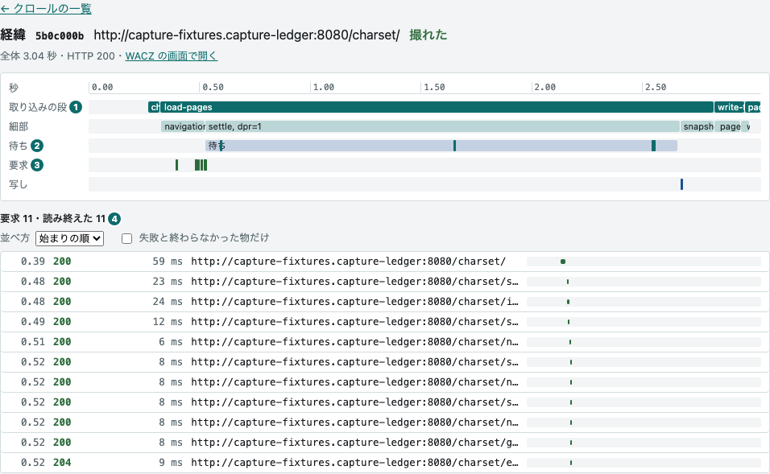

① the bars of the capture's steps\
② the wait after loading, with marks where things went quiet\
③ the marks where each request starts\
④ the list of requests (one bar a row; pressing one shows its fields below)

- **The axis is seconds from the start of the capture.** Zero is when BrowserHive started the
  capture: the time of the first log line minus that line's `ms`. A capture without a log uses
  the time it ended (`timestamp`) minus its processing time (`captureProcessingTimeMs`). The
  heading line gives the total seconds, the document's HTTP status and **Open in the WACZ view**.
- **The bars come from the lines BrowserHive wrote to the log.** **Steps** (取り込みの段) runs from
  the line written on entering a step (`step load-pages` and so on) to the next step's line. **Details**
  (細部) runs from a mark inside a step (a debug line) to the next mark. **Scripts** (スクリプト)
  pairs a script's start line with its end line; a script with no end line runs to the end of the
  axis. console marks the lines the captured page and the scripts wrote. A capture without a log
  (BrowserHive before v24.0.0) has no bars.
- **Wait (待ち) is the time spent waiting for the page to go quiet after loading.** The bar runs
  from the start of the wait to its end, and the marks are load, the network going quiet, the DOM
  going quiet and the CPU going quiet (the answer's `settle`). What never went quiet has no mark,
  and pressing the bar lists it as `never` (静まらなかった).
- **Requests are drawn from the lines BrowserHive put in its answer (`trace`).** From BrowserHive
  v30.0.0, the answer of a capture that asked for a WACZ carries what happened to each request,
  one line per exchange. The **Requests** (要求) row of the figure holds a mark where each request
  starts, and the list below draws one bar a row. A bar runs from the start of the request to its
  end. **A request that did not finish is a dashed bar running to the end of the axis** (it has no
  end). A line with no length is only a start mark (a hollow circle): **Not archived** (残さなかった), **Denied** (止めた), **Stopped tracking** (追うのをやめた) and **End not observable** (終わりを観測できない) — the end is not known, so no length is drawn. A position is the line's `ms`,
  on the same axis as the step bars (BrowserHive wrote it by fitting Chromium's clock to its own
  axis). A length includes the time BrowserHive held the request and the response (matching
  policies, reading the body).
- **The list of requests can be ordered and narrowed.** One row has the start in seconds, the
  status (or the outcome, for a line that has not finished or has no response), the length, the
  URL and the bar. The order is **By start** (始まりの順) or **Longest first** (長い順); the filter is
  **Only failed and unfinished** (失敗と終わらなかった物だけ). The line on top is the count for each
  outcome. It comes from the counts that arrive with the lines (`trace.counts`), which include
  lines dropped at the limit (2,000 lines a capture); when lines were dropped, their number is
  shown too.
- **Pressing a request shows the breakdown of its length and its initiator.** The fields are the
  URL, method, resource type, outcome, start, the time Chromium sent it, length, breakdown,
  initiator, status, protocol, bytes received and the ID of the record that was written (those
  the line has). The breakdown is DNS lookup, connect, TLS, send, wait for the response and
  receive, plus **Other** (ほか): what is left of the length after those six — time queued before
  Chromium sent the request, and time held by BrowserHive. The initiator is the kind of thing
  that caused the request (`parser`, `script` and so on) with its URL and line.
- **End not observable (終わりを観測できない) is not "did not finish".** The end event of a
  cross-site frame's document, and of a dedicated worker's script, does not reach the captured
  page's side. BrowserHive marks such a line to tell it from one that did not finish. The view
  draws no length for it and leaves it out of the **Did not finish** (終わらなかった) count and of the filter.
- **Without a `trace`, the request marks come from the records inside the WACZ.** That is a
  capture by BrowserHive before v30.0.0, or one that did not ask for a WACZ. Requests are marks
  only, not bars (the WACZ has no record that says when a request ended). A filled mark is a
  request paired with its response (a WARC request and response), placed at `WARC-Date` — when
  Chromium sent the request. The bars are placed by BrowserHive's clock and these marks by
  Chromium's, so they can differ a little (0.2 to 0.3 seconds, measured on a local stack). A
  hollow mark is the record of a request that was not paired (a metadata record of the BrowserHive WARC): one of
  **Did not finish** (終わらなかった), **Failed** (失敗した), **Denied** (止めた) and **Not archived** (残さなかった). **It is placed at the time BrowserHive wrote that record, not at the start of the
  request.** Which of the four it is, is written in the metadata's body, so the first 40 are read
  when the view opens and the rest when pressed in the list (until then they say **Not read yet**, 読んでいない).
  A request whose end cannot be observed counts as **Did not finish** in this reading. `Requests N` (要求 N) on the
  top line is the paired ones, counted the same way as the answer's `waczStats.totalRecorded`.
- **Snapshots (写し) is when each DOM snapshot was taken.** With a `trace`, the mark sits at the
  log line BrowserHive writes when it takes the snapshot; without one, at the time of the
  snapshot's record inside the BrowserHive WACZ. Pressing one shows the snapshot's stage and links that open
  it in replay (only when the WACZ may be viewed). The document URL it opens is the answer's
  `document.url` (the URL after any redirect). There is one mark per stage, for the captured page's
  snapshot only: the snapshots of child frames' documents (type **frame snapshot**, 枠の写し, in the
  WACZ view; from BrowserHive v31.2.0) get no mark.
- **Stage screenshots (節目のスクリーンショット) are listed below the figure.** From BrowserHive
  v30.2.0, a BrowserHive server set to take screenshots keeps a picture (WebP) of the captured page's viewport
  at the same stages it snapshots the DOM: `after-load` (after loading) and `after-behaviors`
  (after the scripts). The answer's `screenshots` says, for each stage, the picture it kept or why
  it kept none. The pictures are shown small, in stage order (`after-load` first); pressing one
  shows it at full size in place, and pressing again makes it small (a picture wider than the
  window scrolls inside its box). Under each picture are the stage, when it was taken (seconds on
  the axis, and the record's `WARC-Date`), its size in bytes, and links that open the DOM snapshot
  of the same stage in replay (only when the WACZ may be viewed; the snapshot's URI is built from
  the document URL in the screenshot's URI). The **Screenshots** (節目の絵) row of the figure has a
  mark where each was taken; pressing a mark outlines that picture and shows its fields below
  (stage, time, size, document URL, record ID). A picture itself is a WARC resource record inside
  the BrowserHive WACZ. Its place is found by looking up the WACZ's index (CDXJ) by the screenshot's URI and
  time (one window of index lines; a little more only when the index is longer than 500 lines or
  the screenshot's line is long), and each picture is then fetched by its ``. **For a capture
  that kept no screenshot, the WACZ is not read for screenshots at all.** An identity that may not
  view the WACZ is told so instead of shown the pictures (the ledger gives it no key for the WACZ,
  so the view does not try to read it).
- **A stage with no screenshot says why, in one line.** The reason is the `skipped` BrowserHive
  wrote in its answer, one of five:

  | `skipped` | What the view says |
  | --- | --- |
  | `disabled` | BrowserHive is not set to take screenshots (`--stage-screenshots` is off) |
  | `secret` | the capture was given a secret (its value could show, so no screenshot is kept) |
  | `withheld` | a policy withheld a document, an image or media (this includes a capture that has content-type policies, and a withheld document) |
  | `task-budget` | keeping the screenshot would put the capture over its byte limit (`maxTaskBytes`) |
  | `failed` | it could not be taken (not within 2 seconds, or not tried after an earlier screenshot was given up) |

  When every stage has the same reason there is one line; when the reasons differ by stage, or
  some stages have a picture, there is a line per stage. A reason the view does not know is shown
  as it arrived. A capture whose answer has no `screenshots` field (BrowserHive v30.1.0 or
  earlier) gets nothing here: "kept none" and "has no such field" are different.
- **The screenshot at the failure (失敗の時点の絵) is what the captured page was showing when the
  capture failed.** A BrowserHive server set to take screenshots keeps one picture of the captured page for a
  capture whose document answered 4xx or 5xx, and for one that failed after its document had
  arrived. A capture whose load timed out before the document arrived has none. The capture's
  answer (the ledger's `capture.failureScreenshot`) only says whether there is one. When there
  is, the view gets it from the ledger's
  `GET /api/crawls/:id/pages/:page/trace/failure-screenshot` and shows it the way it shows a
  stage screenshot (pressing it shows the full size). An answer whose type the ledger does not
  give as `image/webp` is not shown as a picture; the view says so instead.
- **The signature covers stage screenshots, not the screenshot at the failure.** Stage
  screenshots are records inside the BrowserHive WACZ, so in a signed WACZ the signature covers them. The
  screenshot at the failure is a file outside the WACZ (a failed capture builds no WACZ), and the
  signature does not cover it. Both hold what the captured page was showing, as it was.
- **The heading line says how many random values were recorded.** From ledger v0.105.0 the answer's
  `capture.random` passes on BrowserHive's summary
  ([`browserhive:capture.random`](https://uraitakahito.github.io/browserhive-specs/wacz-profile/1.26.0/#random)). A capture that recorded values shows
  `N random values recorded` (乱数の控え N 回; N is the answer's `draws`, the value lines in
  `random/values.jsonl`), with `(may be incomplete)` (欠けがありうる) when the answer's `truncated` says lines may be
  missing. A capture that was asked to record but has none says why: `withheld` (the document was withheld, so its
  lines are not kept; 文書を伏せたので残さない) or `failed` (could not be recorded; 控えられなかった). A reason the view does
  not know is shown as it arrived. A capture that was not asked (`not-requested`), and one whose answer has no
  `random` field (an older ledger or BrowserHive), get nothing.
- **Pressing a bar or a mark in the figure shows its fields below**: the start and length of a
  bar, or the time of a mark, in seconds.
- **A capture that failed says which step it stopped in.** The answer of a timeout or a failure
  does not carry the step's name. It is read from the last step line of the log, and the heading
  line gives `stopped in step` (止まった段) with the step's name, and the reason. With a `trace`, the list of requests is shown even when
  there is no WACZ (after a timeout, the request that did not finish stays as a dashed bar).
  Without one there is no list (requests are read from the WACZ).
- **A page whose trace cannot be read shows the ledger's reason**: no answer from a capture, no
  recorded place for `.result.json`, nothing at that place in the store, or a file the contract
  rejects. An identity that may not view the WACZ still gets the list of requests when the
  capture has a `trace` (the lines are part of the capture's answer, not of the WACZ); without
  one it gets the bars and the log.
- **The same capture's log is listed below**, in the same box as **Log** in the pages table, with
  the same filter.
- **The signature does not cover this view.** It lays out what it read from `.result.json` in the
  store (and from the WACZ, for a capture without a `trace`). The same request lines
  are also inside the BrowserHive WACZ, in `trace/events.jsonl` (from BrowserHive v30.1.0; in a signed WACZ,
  under its signature). The records to show as evidence are the ones inside the WACZ.

The arithmetic (axis, bars, marks, request bars, counts, where the screenshots are) is
`public/timeline.js`, pinned by `test/timeline.test.mjs` and `test/timeline-trace.test.mjs` against
real answers from capturing capture-fixtures on a local stack. The screenshot part is pinned by
`test/timeline-shots.test.mjs` against real WACZ files made by BrowserHive captures
(`sandbox/samples/`), and the random values line by `test/timeline-random.test.mjs`.

### The state is worded together with stopReason

`state` alone is not enough. `succeeded` mixes crawls that followed everything to the end with
crawls that were cut at the depth or page limit. The workbench words them apart using `stopReason`
(**Completed**, 完走, when everything was followed; **Cut (depth)** and **Cut (pages)**, 打ち切り (深さ) and
打ち切り (枚数), when a limit cut it), and shows an unknown `stopReason` as it
is, in parentheses. A depth-0 crawl asked not to follow links, so it is not cut even if links are
left over: it reads **This page only** (このページだけ; the ledger's `maxDepth` on the list). A crawl asked to follow links that found
none the rules let through reads **No links** (リンクなし), in the warning colour (capture-ledger's `no_links`): it never got past its
seeds, and that is kept apart from a green **Completed**. If some pages could not be fetched it adds the count (the ledger's
`pagesFailed`), as in `Completed · 2 pages failed` (完走・2 枚取れず), and the row is not green even if everything was followed. A
crawl that captured nothing is closed as `failed` by the ledger, so it reads **Failed** (失敗).

The wording rules are `stateOf` in `public/format.js`, pinned by `test/format.test.mjs`. The
tests read the same file the browser reads, so there is no copy to rot.

## Start a crawl

The **New crawl** view starts a crawl. The left column holds the seed URLs, the registered scripts, the User-Agent box,
the **Record random values** (乱数を控える) checkbox, the per-crawl values (when a ticked script declares any), the depth and the **Start** (始める) button; the
right column holds the box for a script of your own, and how to follow links. The box
stretches to the bottom of the window and has line numbers on its left, so a large script can be
pasted, read, fixed a little and run. Write the seed URLs one per line, choose **This page only**
(このページだけ) or **Follow links** (リンクを辿る), and press **Start**. The right column has tabs: it switches to
a window for reading a registered script, and, while **Follow links** is chosen, to **How to follow**
(辿り方).

① seed URLs\
② スクリプト (Scripts): the run-order numbers, the checkboxes and 読む (Read), and ↑↓\
③ クロールごとの値 (Per-crawl values): the fields for the variables the ticked scripts declare\
④ User-Agent: the box and the button that fills in the pattern without Headless\
⑤ 乱数 (Random values): the checkbox 乱数を控える (Record random values)\
⑥ 始める (Start)

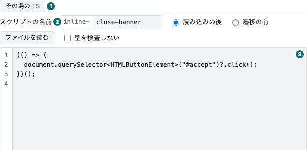

① the right column's tabs\
② スクリプトの名前 (Name of the script)\
③ the script box

- **It sends the seed URLs, whether the depth is 0, what runs — only when it differs from the
  default — and the per-crawl variables, only those with a value.** **This page only** sends `maxDepth: 0`; **Follow links** sends the rules, and the depth
  and the page limit only when they are written (empty, they are the ledger's defaults). With the default set the seeds decide (of the scripts in
  the default, those without sites and the site scripts for a seed's host) ticked and unmoved, and no script of your own, the form
  sends no `scripts`, and the ledger picks the same set in the same order from the seeds. A ledger with no scripts is still a
  400, and so, with its own message, is one in which no script fits the seeds. Otherwise it
  sends `scripts` in the order of the numbers (a script of your own set to **Before navigation**, 遷移の前, goes first);
  unticking all of them sends `[]`, which runs nothing. The workbench checks neither the URLs
  nor the script's name; the ledger says what is wrong with a 400, naming the ids it refused.
- **The numbers show the order the scripts run in, and ↑↓ change it.** The ticked rows are numbered
  and run in that order. They start in the order of `catalog.json` in
  [capture-scripts](https://github.com/uraitakahito/capture-scripts) (from ledger v0.75.0), so ticking
  `autofetch` alone runs it after `autoscroll`. ↑↓ swap numbered rows. Unticking leaves the row where it is and only
  takes away its number and arrows. Site scripts that fit no seed collect at the bottom. A script of
  your own set to **After load** (読み込みの後) gets a row when you write it, first at the top, and moves
  with the others; one set to **Before navigation** gets no row and always runs first. The
  order you set survives re-fetching the list and starting a crawl; reloading the page resets it.
- **A site script can be ticked only when a seed is on its site.** A script with sites can be
  ticked only while one of the seeds is on one of those hosts. The seed's hostname must match
  exactly and its port is ignored (`laws.e-gov.go.jp` and `www.e-gov.go.jp` are different hosts).
  Writing a seed ticks the site scripts that fit it; the others cannot be ticked and say why, as in
  `No seed on laws.e-gov.go.jp` (起点に laws.e-gov.go.jp がありません). With no seed yet, they say
  `Write a seed to choose` (起点を書くと選べます). A box you unticked stays unticked when the seeds
  change. The rule is the ledger's: naming a site script that fits no seed gets a 400 from it.
  The example is `egov-law-search` from capture-scripts (sites `laws.e-gov.go.jp`), which searches law titles
  within [e-Gov Law Search](https://laws.e-gov.go.jp/) for the word in the required variable `query`; seed
  `https://laws.e-gov.go.jp/` to choose it, as in the picture above.
- **The User-Agent box sets the crawl's `User-Agent`.** Left empty, nothing is sent and the browser's
  own value (with `HeadlessChrome`) goes out. The button **Put in the pattern without Headless** (Headless を外す型を入れる)
  fills in `{chrome} BrowserHive`: BrowserHive turns `{chrome}` into the browser's own value without Headless, so
  a site that refuses Headless can be captured, and the text never goes stale when the browser is upgraded.
  For example, the [Prime Minister's Office of Japan](https://www.kantei.go.jp/) answers HTTP 404 to text containing
  `HeadlessChrome`. Started with the box empty and **This page only**, the page ends in
  `failed: http_error: HTTP 404: Not Found`: nothing is captured and no ReplayWeb.page ↗ / Web Capture ↗ appears. Fill in
  `{chrome} BrowserHive` with the button and it is captured and opens with ReplayWeb.page ↗ / Web Capture ↗ (checked on 2026-11-07; what a
  site answers can change). Whether to include the word `BrowserHive` is up to whoever types: with it, a site can tell that BrowserHive took the page and
  robots.txt is read under that name; without it, only the `*` rules are read. The workbench does not check the text:
  the ledger refuses text of the wrong form (printable ASCII, at most 512 characters) with a 400, and the workbench
  shows it under the left column (`400 — The User-Agent must be printable ASCII, at most 512 characters`). The text stays in the box after starting, like the variables and the
  script. The opened row of the crawls view shows the text as typed; the value actually sent is in the BrowserHive WACZ's
  `settings.userAgent`.
- **Record random values (乱数を控える) keeps the random values the captured page's JS received.** Unticked (the
  default), nothing is sent and the ledger's default (not recording) applies. Ticked, the form sends `recordRandom: true`
  (ledger v0.105.0), for **Start** and **Make a schedule** (定期にする) alike. BrowserHive then puts a recorder script into
  the page before the page's own JS, and writes the values the page's JS got from `Math.random`,
  `crypto.getRandomValues` and `crypto.randomUUID` to `random/values.jsonl` in the
  [BrowserHive WACZ](https://uraitakahito.github.io/browserhive-specs/wacz-profile/1.26.0/#random-directory). Replay in Web Capture ↗ (capture-player) returns
  the recorded values, so a page that picks what it shows at random shows what it picked when it was captured;
  ReplayWeb.page ↗ does not return them. The opened row of the crawls view says `Recorded random values`
  (乱数を控えた), and the trace of each capture says how many values were recorded.
- **When a ticked script or your own script declares values, the Per-crawl values (クロールごとの値) box
  appears.** A script declares the variables it reads in its source with
  `const { query } = defineParams(z.object({ query: z.string().min(1).describe("…") }))`. For a script in
  [capture-scripts](https://github.com/uraitakahito/capture-scripts) the declarations are also in the
  `params` of its `catalog.json`; the ledger keeps them with each version and `GET /api/scripts`
  carries them. For your own script, the view asks the ledger once the box has stopped changing for
  800 ms (`POST /api/scripts/check`), so the field also appears after a file is read, **Back to
  the form** and **Use as a template** (下敷きにする). A variable (`kind: variable`) becomes one row with its
  name, its description and a field for the value, or a choice when the declaration is a `z.enum`:
  `query` in the picture above is declared by `egov-law-search` as the search word. A required declaration
  (no `.optional()`) is marked `required` (必須). Only the fields with a value are sent, as `variables`;
  an empty optional field is not sent and the script reads `undefined`.
  The values are remembered: after a 202, and when unticking a script removes its rows, they stay,
  and come back when the script is ticked again. The workbench does not check them: the spelling of a
  name (a lowercase letter, then lowercase letters, digits and `_`, up to 64 characters), at most 32
  per crawl, values up to 4,096 characters and the shape the script declared are the ledger's rules. When a
  required field is empty, a name no script declared is sent or a value does not fit, the ledger answers
  400 naming it before it creates a row (under the left column you read something like
  `400 — Required variables are missing: query`). When your own script's declaration cannot be read, or the ledger
  cannot be asked, the reason is under the box in red: `BH0002` (the form cannot be read without running it),
  `BH0004` (a script that runs before navigation has nowhere to read a variable), or `Cannot check the declarations`
  (宣言を確かめられません) with the status and what the ledger said (its phrase is translated when the
  dictionary has it). Ordinary type errors are not shown
  there; the compile step reports them when the crawl runs. A secret (`kind: secret`) is
  listed under **Secrets used** (使うシークレット) by name only, with no field, and beside the name whether
  the WARC hides or keeps it (the declaration's `archive`; left out, it hides): its value is put by a
  person into the Windmill variable `f/waggle_secrets/<name>`, the ledger checks that it exists
  (otherwise a 400 naming it with its path), and Windmill resolves it for the script on every crawl.
  The value never reaches the workbench or the ledger. In a BrowserHive WACZ, a hidden secret's value is
  replaced by `***` in its WARC, and one declared with `archive: "keep"` stays as it is; either way it is
  gone from the snapshots, the page text and title, and the logs. A hidden value needs at least 8
  characters, and BrowserHive refuses a capture given a shorter one (see "WARC に残すか" in the
  capture-scripts README). When a hidden secret is used while the deployment's formats (the ledger's
  `CAPTURE_LEDGER_CAPTURE_FORMATS`) include PNG, WebP, HTML or MHTML, none of which can have the value
  replaced, the ledger refuses with a 400 before it creates a row, naming the secrets and how to fix it
  (under the left column: `400 — Secrets the formats cannot hide: api_token (png in CAPTURE_LEDGER_CAPTURE_FORMATS cannot replace the values …)`; the part in parentheses is the ledger's reason. A ledger from before v0.102.0 sends it only as a Japanese sentence, and it is then shown in Japanese).
  Declaring one name as kept in one script and hidden in another gives
  `400 — Conflicting params: api_token`. No bundled script declares a secret,
  so this view passes variables only; your own script can declare a secret (`inline.params`) only when
  calling the ledger's API directly.
- **A script left out of the default is listed unticked.** It reads **Does not run by default**
  (既定では走らない) beside its name, as autofetch does in the picture above: a script whose entry in the
  `catalog.json` of [capture-scripts](https://github.com/uraitakahito/capture-scripts) says
  `"default": false`, every version of which the ledger keeps disabled. A crawl that names no
  scripts does not run it. Tick it and the form names it, and the ledger runs its newest version. A
  box you ticked is remembered like one you unticked, and a fetch does not reset it.
- **It shows the size before sending.** Under the box are the number of lines, the size of the body
  it will send (UTF-8 bytes) and how much of the limit that is. The limit is the one the writing
  route enforces, handed out by the server as `writeLimit` in `/healthz`. Over it, the line turns
  red and **Start** cannot be pressed.
- **The name of your script becomes its id.** Write it in the box labelled **Name of the script**
  (スクリプトの名前) in the right column. The `inline-` in front stays: `close-banner` gives the id
  `inline-close-banner`. Start with a lowercase letter, then use only lowercase letters, digits and
  `-`, up to 57 characters (the ledger's rule). This view does not check it: a wrong or empty name is
  refused by the ledger with a 400, and under the left column you read something like
  `body/scripts/0/inline/name must match pattern "^[a-z][a-z0-9-]*$"`. The name is sent only when
  the box holds a script; with an empty box it is not used. The id appears in a crawl's list of what
  ran, as the source of its lines in a page's log, and in the archive's `behaviors/custom.jsonl`.
  BrowserHive attaches it to the lines your script logs (`__bh.log.info(…)` and so on) and reports
  (`__bh.report(…)`), so the script itself never writes it. **Back to the form** fetches your
  script back by this name.
- **A script of your own is type-checked as strict TypeScript** at the first level's compile step,
  and a single error fails the crawl; open its row to read the number of diagnostics and the first
  five. Wrap it in an IIFE, give the elements you look up a type, and use `?.`. It cannot contain
  `export`: compile stops it with `BH0006`, because the page would get a syntax error and nothing
  would run.
- **It can use Zod.** Start with `import { z } from "zod"` or `import * as z from "zod/mini"`. Compile
  stops any other form with `BH0003`, and stops a script set to **Before navigation** with `BH0004`.
  ts-compile-service bundles only the names in use into the JavaScript, which adds about 85 KB to the
  script (15 KB for `zod/mini`). A crawl still succeeds when a value has the wrong shape, so use
  `safeParse` and `__bh.log.error` rather than `parse`.
- **For a bundled script, tick Skip the type check (型を検査しない).** Ticking it puts
  `// @ts-nocheck` on the first line of the box, and unticking takes it off: what you see is what is
  sent, and the ledger's sha256 covers it too. A pasted script that already starts with that line
  shows the box ticked.
- **The box does not wrap lines,** so the line numbers stay in step; long lines scroll sideways.
  **After load** runs once in the main frame; **Before navigation** runs in every
  frame on every navigation and has no `__bh`. **Read a file** (ファイルを読む) loads a file into the
  box, in the browser only; if the name box is empty, it takes the file name without its extension.
  Fix it before starting if it breaks the rule above (capital letters or `_`).
- **A registered script can be read in the right column.** Press **Read** next to its checkbox:
  a second tab opens in the right column, named like `autoscroll v2`, with the source of that
  version in colour. The view does not change. The box is only hidden: your script, its scroll
  position and the cursor stay, and the **Your script** (その場の TS) tab brings it back. You can tick
  and untick while reading, and read a site script whose checkbox is disabled. One script is open
  at a time; another **Read** replaces it, and × closes it. The window has **Copy** (写す), **Use as a template**
  and a link that opens the script in the [script collection view](#script-collection), which alone
  has the version chips and line URLs. With ⌘ or Ctrl held, the browser opens the script collection view in
  another tab instead.

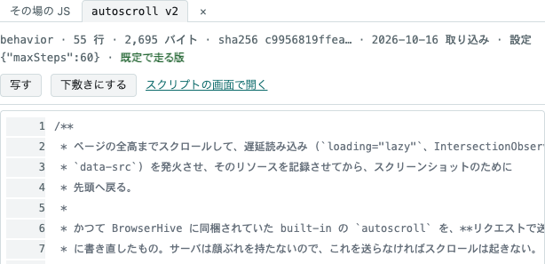

- **Follow links opens the How to follow tab.** It holds the depth and the page limit, the
  presets, and the rules. A rule is an action — **Capture and follow** (撮って辿る), **Capture only**
  (撮るだけ) or **Drop** (落とす) — and what it matches: `same-origin`, `same-host`, `same-site` or `any`
  (compared with the seeds), a lower-case host name (that host and the subdomains under it), or an
  `http(s)` URL (a prefix). The ledger tries the rules from the top, the first match decides, and a
  link no rule matches is dropped. The tab starts with **Within the host** (ホストの中); the presets
  **Within the site** (サイトの中), **Within the site, one step outside** (サイトの中＋外は 1 歩),
  **Within the host** and **Anywhere** (どこでも) each hold a **Capture and follow** rule, because the ledger refuses seeds
  that do not land on one. **+ Add a drop rule (goes at the top)** (＋ 落とす行を足す（いちばん上に入る）) puts
  a drop rule at the top — below a broad **Capture and follow**
  rule it could never match. The ↑ ↓ × buttons name their row for screen readers, and focus follows
  the row that moved.

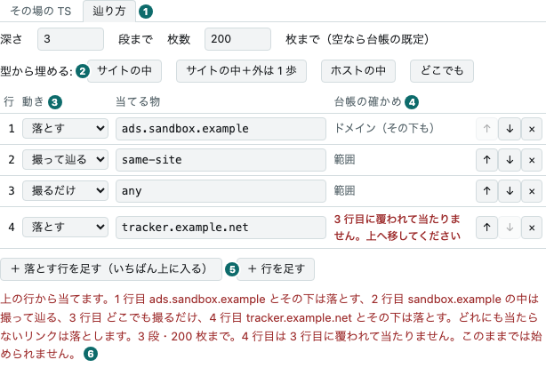

① 辿り方 (How to follow)\
② the presets\
③ the action of each rule\
④ the ledger's check of each rule\
⑤ adding a drop rule at the top\
⑥ what the crawl will do, restated

- **The ledger checks the rules as you write them.** After a 300 ms pause the view asks the ledger's
  `GET /api/crawl-rules/check` (it writes nothing, so it rides the same pass-through as the
  lists). Each row then says what the ledger read — `scope` (範囲), `domain (and its subdomains)` (ドメイン（その下も）) or `prefix`
  (前方一致) — or, in red, that it cannot be read or that an earlier row covers it; the sentence
  under the table restates what will be followed, in the ledger's reading (a URL prefix appears
  normalised). While the ledger says the rules cannot start, **Start** cannot be pressed. When the
  ledger cannot be asked, nothing is blocked: starting gets its answer instead.
- **A 202 or a 409 takes you to the crawls view.** When the crawl is accepted, its row gets a mark;
  if a crawl is already running, the row in the way gets the mark (the ledger runs one crawl at a
  time, overall). An accepted crawl is running, so the footer starts polling every 2 seconds.
  Anything else (a 400, a 413, an unreachable server) stays in this view, as one line under the
  left column: the status and the reason. A refusal from the ledger is shown in the screen's
  language when the dictionary has its phrase and its reasons, and as it arrived when it does not.
- **After a 202 the seed URLs are cleared; your script and the values of the variables are kept,**
  since the usual next step is to fix it and run again.
- **Back to the form brings you back here.** Open a row in the crawls view and press
  **Back to the form** on a script of your own: this view opens with its name, phase and source. The source
  comes from the ledger's `/api/crawls/:id/inline/:name` (a crawl's detail only carries its size).
  The seed URLs and the ticked scripts are left alone. If the right column was showing a registered
  script, it switches back to the **Your script** tab.
- **Use as a template in the [script collection view](#script-collection) brings a registered script
  here** as a script of your own, named `my-<id>` unless the name box already has one. Only the form
  that names the script's own id, `__bh.opts["<id>"]` (where it reads its options), is changed to
  `inline-<name>`; reports and log lines take no id, so they are left alone. The message under the
  left column says on which lines. The original is unticked,
  so it does not run twice. If the box already holds a script, the script collection view asks before
  replacing it. **Use as a template** in the right column's reading window does the same, and asks inside
  that window; afterwards the **Your script** tab is in front, and the reading window stays open for
  comparing. A site script's sites do not come along: a script of your own runs from any seed,
  and the check at the top of the script (comparing `location.hostname`) keeps it idle on other
  sites.
- **The types of `__bh` are one link away.** The note under the left column links to them
  (`#scripts/types/host.d.ts`); a plain click opens them in the right column's reading window.
- **The row gets a mark, and is not opened.** The mark is remembered by id and put back each time
  the table is redrawn.

It is sent through `POST /api/crawls` in [Routes](/routes/).

## Schedules

The schedules and their runs (`#schedules`). The clock lives in
[capture-ledger](https://github.com/uraitakahito/capture-ledger); this view reads the state and asks
for actions.

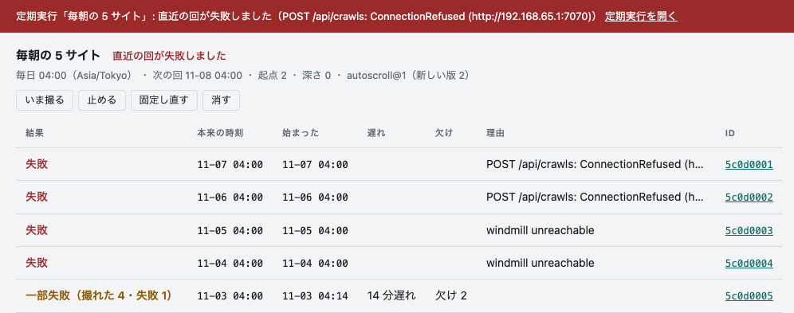

- **A run that did not capture shows on a band on every view.** The band appears for three things —
  the latest run failed, the next run is an hour or more late, a run has been running for an hour or
  more — and when the state cannot be read. It cannot be dismissed; it goes away when the cause is
  fixed. The tab also carries the number of schedules on the band.
- **Queueing does not show on the band.** Only one crawl runs at a time, so a due schedule waits for
  a running crawl, and for 10 minutes (quiet) after the ledger starts and after the latest crawl. The
  due time does not move while it waits, and the run starts afterwards.
- **Runs missed while the ledger was down merge into one.** It captures once when it comes back, and
  the merged count shows under **Missed** (欠け).
- **A run where only some pages failed says Partly failed (一部失敗).** It stays off the band: a site that fails every
  day would keep the band up, and nobody would read it.
- **Run now (いま撮る) does not wait for quiet.** It queues behind a running crawl, and works on a
  paused schedule.
- **How to capture is pinned when the schedule is made.** A new script version does not change what a
  run does (it shows as `autoscroll@1 (newer version 2)`; `autoscroll@1（新しい版 2）` on the Japanese screen). **Repin** (固定し直す) moves it up.
- **A row left running is not closed for you,** so that a run that really is running does not get
  closed. If it blocks the next run, **Close the row … left running** (走ったままの行 … を締める) appears, and closes that crawl as failed.
- **Schedules are made on the new crawl view.** Fill in the form, write a name and a cron expression
  (5 fields, Asia/Tokyo), and press **Make a schedule** (定期にする). The checks are the same as **Start**, with the same words
  when refused. The ledger sets the minimum gap between runs (60 minutes by default). There is no
  editing: delete and make it again.

Rows on the crawls view carry a `scheduled` (定期) mark, and `scheduled · 2 missed` (定期・欠け 2) when runs were merged.

## Changes

How a scheduled run differs from the previous run of the same schedule with the same recipe
(`#changes`, `#changes/<crawl id>`, `#changes/<crawl id>/<WACZ id of this run>`). Comparing and summarizing happen in
[capture-ledger](https://github.com/uraitakahito/capture-ledger); this view only reads.

The list's **Started** (始まった) column is when the run started. The list is in that order, and only a run that started a
minute or more late adds its due time and the delay, as in `(due 11-08 04:00 · 2 days late)` (（本来 11-08 04:00・2 日遅れ）). Clicking a row hides the list and
opens the run; **← Change list** (← 変化の一覧) goes back.

- **Every page on the left, one page on the right.** The list holds every page the run compared, by weight (a
  change of content, a small change, nothing that matters, a diff without a summary, a diff that could not be built),
  then the pages that were the same (**The same**, 同じ). The first one opens. The rows and **← Previous page** / **Next page →** (← 前のページ / 次のページ →) rewrite
  the URL, so the browser's back button returns to the previous page and a shared URL opens the same page. When the
  named page is not in the run (a WACZ you may not view, an old URL), the view says so and shows the first page. A
  narrow window puts the list above the page.
- **The diff comes from the evidence; the summary only makes it easier to read.** capture-ledger
  builds the diff from the two WACZ files without Claude. The run's summary carries
  `Claude's summary (not evidence)` (Claude の要約（証拠ではない）) with the model, the prompt version and
  the cost, and each page's line from Claude carries `(not evidence)`. To check, open both with the two viewer links
  after **Before:** and **After:** (前: and 今:).
- **Claude's summary and lines are in Japanese on either screen.** capture-ledger has them written in
  Japanese, and the workbench does not translate them. On the English screen, a page's line from
  Claude is followed by `The summary is written in Japanese.`
- **Clicking a quote moves to its line.** A diff line holding a quote from Claude is marked on the left.
- **Pages that were the same** (same text, or only blank lines and indentation changed) show only the viewer links.
  Pages that were not compared (in only one run, withheld, without a text digest) are not listed.
- **Three weights:** nothing that matters (only a time moved; green), a small change (a promotion swapped; amber),
  and a change of content (an article or a fact; blue). Claude decides and can be wrong; the diff stays.
- **Quotes that are not in the diff are marked** in red with `(not in the diff)` (（差分に無い）).
- **A stalled summary shows on the band** — when the latest run's summary hits the monthly limit, or
  failed three times. A change of content itself never raises the band.
- **Pages with a WACZ you may not view are left out.**
- **It is fetched when opened**, not polled: runs change a few times a day.

## Archives

The WACZ files you can see, newest capture first.

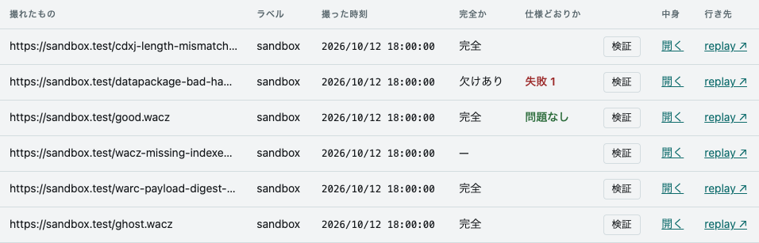

- **The URL under Captured (撮れたもの) takes the same two lines as a crawl's seed.** The top line is
  the path and query, the bottom line the origin. Hover over the cell to read the whole URL.
- **A `—` under Complete? (完全か) means "unknown".** The ledger's `waczComplete` is null for
  that row, which is not the same as **Incomplete** (欠けあり).
- **Validate (検証) only runs when you press it.** Opening the list does not run it. The result
  also stays in the row's **Conforms?** (仕様どおりか) cell, so after looking at several archives you
  can tell how each one did without pressing again. Reloading the page clears them. The report comes
  back in the language of the screen. What it shows is in
  [Inspecting a WACZ](/wacz/).
- **Open (開く) enters the WACZ view** (`#wacz/<archiveId>`).
- **"ReplayWeb.page ↗" and "Web Capture ↗" open the captured URL in a viewer.** The link is built from the replay origin the
  server hands out through `/healthz`, the `objectKey` the ledger returns, and the row's URL and
  capture time (`#view=replay&url=…&ts=…`). The page's own scripts run there, so pictures that the
  page shows with JavaScript appear too. The DOM snapshots BrowserHive took (before and after the
  scripts) are on replay's Pages tab. replay does not pick a start page on its own: it lists the
  pages newest first, and it does not read the WACZ's `mainPageURL`. It opens that one WACZ: to
  follow links into the crawl's other pages, open the crawl with ReplayWeb.page ↗ / Web Capture ↗ on its row in the
  [crawls view](#crawls).

## Search

The view that searches the titles and text of captured pages with the ledger's full-text search
(`#search/<words>`).

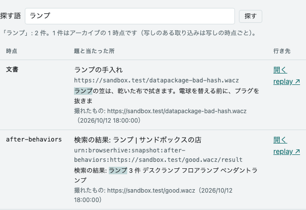

- **A hit is one stage of one archive.** The ledger indexes each line of a WACZ's page list: for a
  BrowserHive WACZ with snapshot lines only the snapshots (`after-load`, `after-behaviors`), and for a capture
  without snapshots (a document a policy withheld, say) the document's line. When both the
  `after-load` and the `after-behaviors` stage of one archive match, two rows are listed.
- **Only archives you may see are listed.** The ledger filters with the same authorization as the
  archive list. The count is the number of rows listed; the ledger returns at most 50 at a time.
- **ReplayWeb.page ↗ / Web Capture ↗ open a document hit at the captured URL, and a snapshot hit at the snapshot itself.**
  The document opens with the page's scripts running; a snapshot is the DOM copy without scripts,
  the page as it was at that stage.
- **Open enters the WACZ view** (only for archives listed in the archives view).
- **It fetches only when you press Search (探す) or open a search URL.** It does not poll like the
  other views.
- **It needs the ledger's full-text search (OpenSearch).** When that does not answer, the reason is
  shown in one red line (the ledger's `CAPTURE_LEDGER_OPENSEARCH_URL`).

## Script collection

The scripts that run inside the pages being captured, to read before writing one of your own, or
to see exactly what a crawl ran. On the left is a list in four groups: the scripts that run by
default (the newest enabled version of each id without sites, which is what a crawl runs when it
names none), the site scripts (those with sites, which run only when a seed is on their site), the
scripts that do not run by default (under **Do not run by default (run when chosen)**, 既定では走らない（選べば走る）, those with no enabled version, whose
newest version runs when a crawl names them), and, under **Types to write against** (書くための型),
`host.d.ts`, the types of `__bh`, the object the capture server puts in the page for scripts to
use. All but `host.d.ts` also appear as checkboxes under **Scripts** in the
[new crawl view](#start-a-crawl) (those that do not run by default unticked), where **Read**
next to one opens it in the right column.

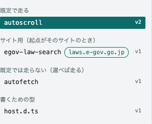

On the right is the TypeScript the ledger keeps, before it becomes JavaScript, with line numbers.

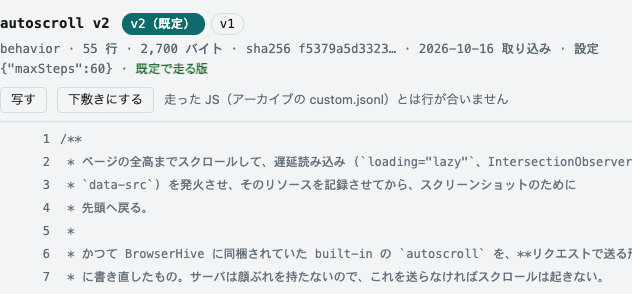

| URL | Opens |
| --- | --- |
| `#scripts` | the first script in the list (the URL changes to name it) |
| `#scripts/autoscroll` | the version that runs by default (for a script that does not, the newest) |
| `#scripts/autoscroll@1` | version 1, enabled or not |
| `#scripts/autoscroll@1:33` | version 1, with line 33 marked and scrolled into the middle |
| `#scripts/types/host.d.ts` | the types of `__bh` |

- **The heading says which version you are reading.** Chips list every version of the id, the
  default one marked `(default)` (既定) and disabled ones `(disabled)` (無効). Under them are the line count, the size, the start of the sha256, the day
  it was imported, the options it is given (`{}` means the defaults written in the code), and
  whether it is the version that runs by default. A site script has its sites beside its name, and
  its default version reads `Runs by default when a seed is on laws.e-gov.go.jp`
  (起点に laws.e-gov.go.jp があれば既定で走る版). A disabled version reads `Disabled (does not run by default)`
  (無効（既定では走らない）).
- **Sites mark a script that only makes sense on certain sites.** The sites (`sites`) are a list
  of hostnames, written in the `catalog.json` of
  [capture-scripts](https://github.com/uraitakahito/capture-scripts) and kept by the ledger with
  each version. A site script runs by default only when one of the crawl's seeds is on one of those
  hosts. The rule holds for the whole crawl, so the script also runs on pages of other hosts the
  crawl reaches by following links; the script checks the hostname first and does nothing
  elsewhere.
- **Click a line to put it in the URL,** to send someone straight to it. This adds nothing to the
  browser history and does not redraw the view.
- **Copy (写す) puts the source on the clipboard.** **Use as a template** takes it to the
  [new crawl view](#start-a-crawl) as a script of your own.
- **The source is colored.** The colors come from [Shiki](https://shiki.style) with the same
  TypeScript grammar as VS Code, in GitHub Light High Contrast or GitHub Dark Default to follow
  the screen's light or dark scheme (the pair whose colors all stay readable on the screen's
  backgrounds). The lines appear in one color first and the colors follow a moment later: the
  coloring runs off the page's main thread (in a worker), so even a long file can be read and
  scrolled at once. The marked line stays one color. If the colors cannot be loaded, a line above
  the source says so, and the source stays readable in one color.
- **The lines are the TypeScript's.** A crawl runs the compiled JavaScript, which is what the archive
  keeps in `behaviors/custom.jsonl`, and its lines are a few off from these in places.
- **Read in a crawl's detail opens the version that crawl ran,** and carries the start of its
  sha256 as well. Version numbers can be reused (removing the newest version and adding one again
  gives the number to different bytes), so when the bytes differ, the view says so above the source.
- **Only what you open is fetched.** The list comes with the regular fetch and is redrawn only when
  it changes. The versions and the source of a script are fetched when you open it, and the types
  of `__bh` once, when you first open the view. The routes are capture-ledger's
  `GET /api/scripts/:id/versions`, `GET /api/scripts/:id/versions/:version` and
  `GET /api/host-types` (from v0.60.0; the sites from v0.61.0; the list, `GET /api/scripts`,
  carries the scripts that do not run by default, with `enabled: false`, from v0.64.0), passed through as in
  [Routes](/routes/).

**A ledger with no scripts is shown in red.** The capture server (BrowserHive) does not bring any scripts
of its own, so with no scripts in the ledger nothing runs inside the page. Nothing scrolls and nothing
lazy-loads, yet the capture still succeeds and an archive still comes out. The red message
includes the command that imports the scripts with [capture-ledger](https://github.com/uraitakahito/capture-ledger) (the
ledger that starts crawls and records what came back).

## Polling

While at least one crawl is running, the lists are fetched every 2 seconds; otherwise every 30
seconds. A crawl that has just finished keeps the 2-second pace until its last bundle version shows
up, for at most a minute. Without keeping a copy, the workbench still looks live while something runs, and stays
quiet when nothing does. The search and changes views do not poll; they fetch only when you search or open them. Schedules
are fetched on a separate loop, every 30 seconds, and every 5 seconds while one is queued or running.
It is separate so that being unable to read schedules does not stop the crawl table too.

When a fetch fails, the workbench keeps the last tables it could draw and shows the reason at the
top (see "Fix it from the message" in the [Quickstart](/quickstart/)).
